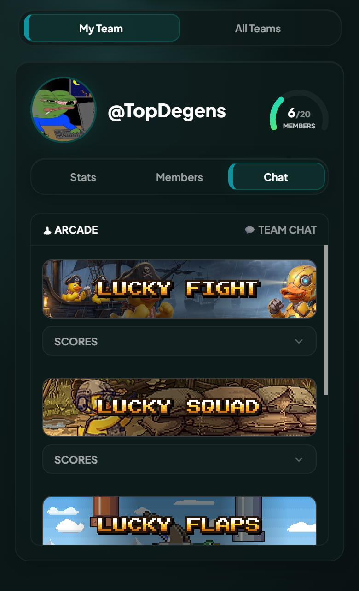
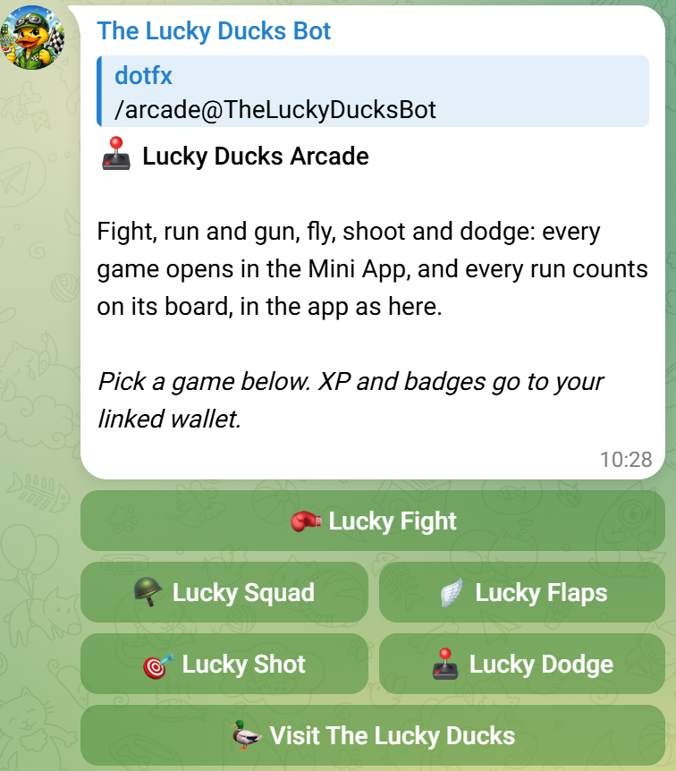

# The Arcade

The Arcade is five quick games, [**Lucky Fight**](lucky-fight.md), [**Lucky Squad**](lucky-squad.md), [**Lucky Flaps**](lucky-flaps.md), [**Lucky Shot**](lucky-shot.md) and [**Lucky Dodge**](lucky-dodge.md). You play them on the site and in Telegram, each game has one leaderboard for both, and with your Telegram account linked to your wallet a good run earns XP and [badges](../competition/badges.md#arcade).

## Where to play

**On the site**, the arcade is on the back of the chat panel, in a race lounge and in your team's chat: flip the panel over and pick a game. It opens in a game window with its name on a bar at the top, and the bar's buttons put it in full screen and close it. On a desktop you can move the window by that bar and resize it from its edges, and it stays open while you move around the site; on a phone it fills the screen. Wherever you play it, a run counts on that game's one leaderboard, not on a lounge's or a team's.


{% column width="70%" %}

<figure><figcaption><p>One button per game, each with its board shared with Telegram.</p></figcaption></figure>



{% column width="30%" %}

<figure><figcaption><p>On a phone</p></figcaption></figure>




**In Telegram**, `/arcade` posts a button for each game: Lucky Fight on a row of its own, then the others two to a row, with a **Visit The Lucky Ducks** button to the site under them. `/play`, `/game` and `/games` do the same. Each game also has a command of its own: `/luckyfight`, `/luckysquad`, `/luckyflaps`, `/luckyshot` and `/luckydodge`. A group answers only the commands switched on for it, so its `/arcade` shows only those games, and always the button to the site. See [The Lucky Ducks Telegram bot](../help/telegram-bot.md).

<figure><figcaption><p>One button per game the group has switched on, and always one to the site.</p></figcaption></figure>

On the site and in Telegram, Lucky Squad, Lucky Flaps, Lucky Shot and Lucky Dodge open on a start screen: the game's name, how to play, your best and the XP you have earned today once you are signed in, then **PLAY** with the game's board under it. On a phone held sideways the board is left out, since there is no room for it. Lucky Squad and Lucky Flaps have their own buttons in place of **PLAY**: see [playing in a squad](lucky-squad.md#playing-in-a-squad) and Flock mode under [Lucky Flaps](lucky-flaps.md). Lucky Fight has a start screen of its own: see [Lucky Fight](lucky-fight.md). When a new version of Lucky Squad or Lucky Flaps is out, its start screen shows **SOLO MODE** first and **RELOAD** second. In Telegram, Lucky Flaps' board gives each row's stage reached, and Lucky Dodge's gives each row's level, and an account not linked to a wallet sees a notice with a **LINK WALLET** button in place of its best and XP. Every run then opens with a 3, 2, 1 countdown and a reminder of the controls.

**In Telegram your avatar plays with you**: in Lucky Shot at the right end of the bank, level with the round's tally, and in Lucky Dodge at the bottom right. With a wallet linked it is your profile picture, or the first two characters of your wallet, with the green dot once you are [verified](../trust/verification.md). A Telegram account linked to no wallet shows its Telegram photo, with the Telegram badge where the dot would be.

**The online lobbies have a limit.** The team can cap how many online games of Lucky Fight, Lucky Flaps and Lucky Squad run at once, across the whole platform and, separately, for the games started from one Telegram group's posts. Only a new game counts: a player waiting for a challenger in Lucky Fight, then their fight, an open flock in Lucky Flaps, and a live squad in Lucky Squad. Joining one that is already open never counts and is never turned away. While a limit is reached:

- **Lucky Fight** greys out **OPEN A CHALLENGE**. **SOLO MODE** and **JOIN** still work, and it is never full while another player is waiting for someone to fight.
- **Lucky Flaps** greys out **OPEN TO THE FLOCK** with a line saying the online lobbies are full. **SOLO MODE** and **JOIN THE FLOCK** still work.
- **Lucky Squad** greys out **OPEN A SQUAD** the same way. **JOIN** still works.

The start screen checks again every 15 seconds, so a greyed button comes back as soon as a lobby frees up.

## Leaderboards

Each game has one leaderboard, the same on the site and in Telegram, so a run counts wherever you play it. Your best run is your place on it.

You can play in Telegram before linking a wallet. Your runs then rank under your Telegram account, marked with a **TG** badge, and when you link a wallet your best moves to it, the better of the two kept if the wallet already had one. See [Player verification](../trust/verification.md).

## XP and badges

XP and badges go to a wallet, so in Telegram they need your account linked to one. Each game pays XP up to 50 a day, counted from 00:00 UTC:

- **Lucky Fight**: 3 XP for finishing a fight, 7 more for winning it, and 3 for each round you win at full health. A fight that ends in its first seconds pays nothing.
- **Lucky Squad**: 5 XP for each arena you clear, the boss's arena once the Heron Walker is down.
- **Lucky Flaps**: 5 XP for each stage you clear.
- **Lucky Shot**: 5 XP for each round you clear.
- **Lucky Dodge**: 5 XP for each level you clear.

Each game has three badges: your best score earns them in Lucky Squad, Lucky Flaps, Lucky Shot and Lucky Dodge, and the fights you win in Lucky Fight. See [Badges](../competition/badges.md#arcade).

## Sharing a run

When a run ends, the share button, a round disc on the top right corner of the score plate, posts your score with a link to the game: on a phone it opens your phone's share menu, and otherwise you pick X, Telegram or copying the link. The link shows the game's card in the post, and a phone's share menu attaches the card animated. Whoever opens the link lands in the game.



```
theluckyducks.com/arcade/luckyfight
theluckyducks.com/arcade/luckysquad
theluckyducks.com/arcade/luckyflaps
theluckyducks.com/arcade/luckyshot
theluckyducks.com/arcade/luckydodge
```


