# The Arcade

The Arcade is five quick games, **Lucky Fight**, **Lucky Squad**, **Lucky Flaps**, **Lucky Shot** and **Lucky Dodge**. You play them on the site and in Telegram, each game has one leaderboard for both, and with your Telegram account linked to your wallet a good run earns XP and [badges](../competition/badges.md#arcade).

## Where to play

**On the site**, the arcade is on the back of the chat panel, in a race lounge and in your team's chat: flip the panel over and pick a game. It opens in a game window with its name on a bar at the top, and the bar's buttons put it in full screen and close it. On a desktop you can move the window by that bar and resize it from its edges, and it stays open while you move around the site; on a phone it fills the screen. Wherever you play it, a run counts on that game's one leaderboard, not on a lounge's or a team's.


{% column width="70%" %}

<figure>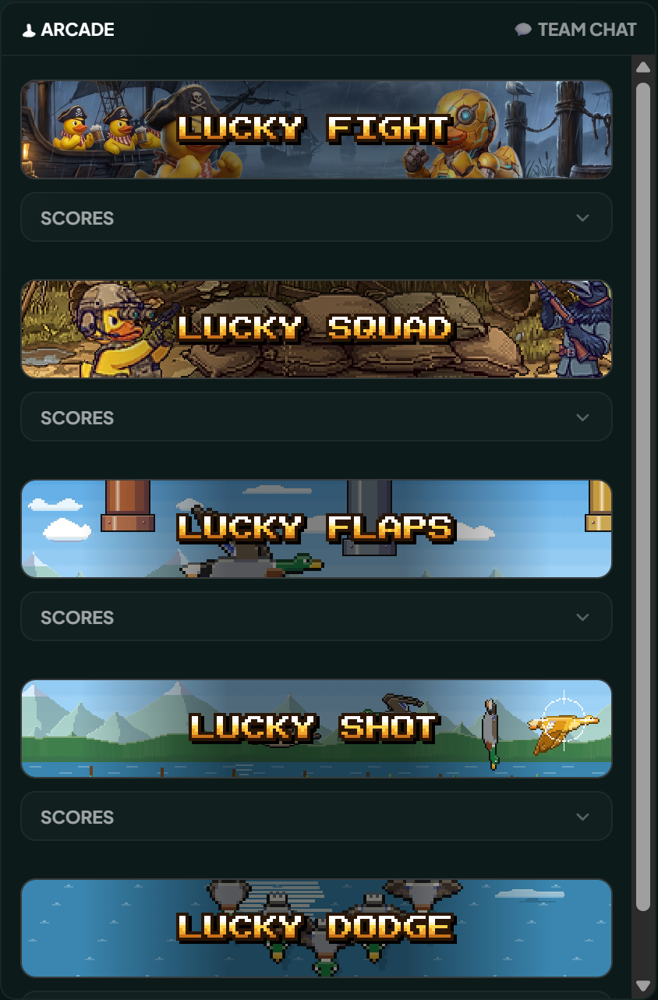<figcaption><p>One button per game, each with its board shared with Telegram.</p></figcaption></figure>



{% column width="30%" %}

<figure><figcaption><p>On a phone</p></figcaption></figure>




**In Telegram**, `/arcade` posts a button for each game: Lucky Fight on a row of its own, then the others two to a row, with a **Visit The Lucky Ducks** button to the site under them. `/play`, `/game` and `/games` do the same. Each game also has a command of its own: `/luckyfight`, `/luckysquad`, `/luckyflaps`, `/luckyshot` and `/luckydodge`. A group answers only the commands switched on for it, so its `/arcade` shows only those games, and always the button to the site. See [The Lucky Ducks Telegram bot](../help/telegram-bot.md).

<figure><figcaption><p>One button per game the group has switched on, and always one to the site.</p></figcaption></figure>

On the site and in Telegram, Lucky Squad, Lucky Flaps, Lucky Shot and Lucky Dodge open on a start screen: the game's name, how to play, your best and the XP you have earned today once you are signed in, then **PLAY** with the game's board under it. On a phone held sideways the board is left out, since there is no room for it. Lucky Squad and Lucky Flaps have their own buttons in place of **PLAY**: see [playing in a squad](#playing-in-a-squad) and Flock mode under [Lucky Flaps](#lucky-flaps). Lucky Fight has a start screen of its own: see [Lucky Fight](#lucky-fight). When a new version of Lucky Squad or Lucky Flaps is out, its start screen shows **SOLO MODE** first and **RELOAD** second. In Telegram, Lucky Flaps' board gives each row's stage reached, and Lucky Dodge's gives each row's level, and an account not linked to a wallet sees a notice with a **LINK WALLET** button in place of its best and XP. Every run then opens with a 3, 2, 1 countdown and a reminder of the controls.

**In Telegram your avatar plays with you**: in Lucky Shot at the right end of the bank, level with the round's tally, and in Lucky Dodge at the bottom right. With a wallet linked it is your profile picture, or the first two characters of your wallet, with the green dot once you are [verified](../trust/verification.md). A Telegram account linked to no wallet shows its Telegram photo, with the Telegram badge where the dot would be.

**The online lobbies have a limit.** The team can cap how many online games of Lucky Fight, Lucky Flaps and Lucky Squad run at once, across the whole platform and, separately, for the games started from one Telegram group's posts. Only a new game counts: a player waiting for a challenger in Lucky Fight, then their fight, an open flock in Lucky Flaps, and a live squad in Lucky Squad. Joining one that is already open never counts and is never turned away. While a limit is reached:

- **Lucky Fight** greys out **OPEN A CHALLENGE**. **SOLO MODE** and **JOIN** still work, and it is never full while another player is waiting for someone to fight.
- **Lucky Flaps** greys out **OPEN TO THE FLOCK** with a line saying the online lobbies are full. **SOLO MODE** and **JOIN THE FLOCK** still work.
- **Lucky Squad** greys out **OPEN A SQUAD** the same way. **JOIN** still works.

The start screen checks again every 15 seconds, so a greyed button comes back as soon as a lobby frees up.

## Lucky Fight

<figure>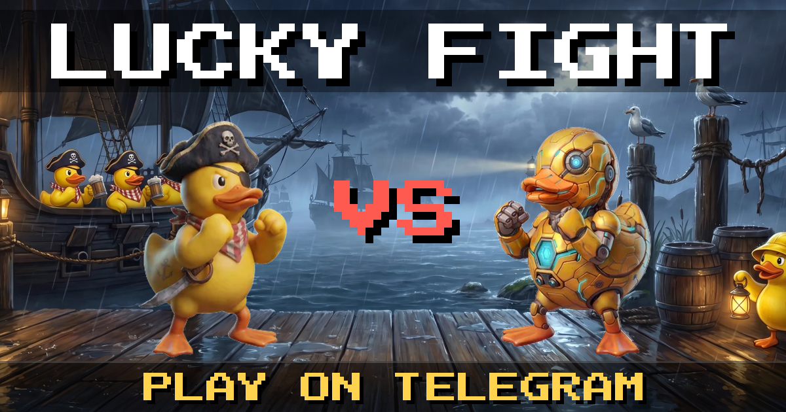<figcaption><p>Pick a duck and fight, live.</p></figcaption></figure>

`/luckyfight`, or `/fight`, posts the game with a **Play Lucky Fight** button that opens it inside Telegram, over the whole screen. While the game's art downloads, a loading screen shows its title over a gold ring and the file it is loading, with a button to try again if a download fails.

Lucky Fight opens on a start screen, on the site as in Telegram: your wins, your streak and the XP you have earned today, the board, and the ways to fight.

- **SOLO MODE** fights the computer at once, with no wait.
- **OPEN A CHALLENGE** asks whom the challenge is for, in one field: a wallet, a player's nickname picked from the suggestions, or a Telegram @handle. **Anyone**, offered first, opens it to whoever comes. **OPEN** then waits for your challenger.
- **JOIN** blinks in **OPEN A CHALLENGE**'s place, with the challenger's avatar inside, when a challenge names you or someone is waiting for a fight, and pairs you with them.

<figure>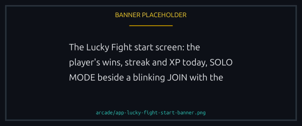<figcaption><p>Fight the computer at once, open a challenge, or take the one waiting for you.</p></figcaption></figure>

A challenge naming a player can be taken only by that player, matched by their wallet or by the Telegram handle their account is linked to, and one named by @handle only from Telegram. You never fight your own account.

Online, once your duck is ready it waits for your opponent's. Pick a duck and fight another player, live: punch, kick and land specials, and the first to win two rounds takes the fight. Each round has a 60 second clock, and when it runs out the duck with more health left wins the round. If nobody takes your challenge, you fight the computer instead: the wait is 60 seconds unless the group the post came from has set another, from 10 seconds to 2 minutes. You stay in the queue while you fight the computer, so a player who joins then still reaches you: the fight against the computer stops, it counts for nothing, and you both go on to pick your ducks. Play on a keyboard or on a phone: held upright the fight sits between black bands, and turned sideways it fills the screen. On a phone the movement pad stays, faint, where your thumb last lifted.

**On the site**, Lucky Fight pairs you only with players in the same lobby: your team's chat opens your team's, and a race lounge's chat that race's. Only players on the site meet there, but a challenge you name for a player reaches them wherever they open Lucky Fight, Telegram included. While someone is waiting for a fight in that lobby, the game's button in the arcade says so, and **JOIN** pairs you with them. If nobody comes within 60 seconds, you fight the computer, and a player who arrives then still reaches you, as in Telegram. A lounge's spectator, who is not in the race, sees Lucky Fight switched off. A fight on the site counts on the same board and pays the same XP and badges, but is not posted in any chat.


{% column width="70%" %}

<figure>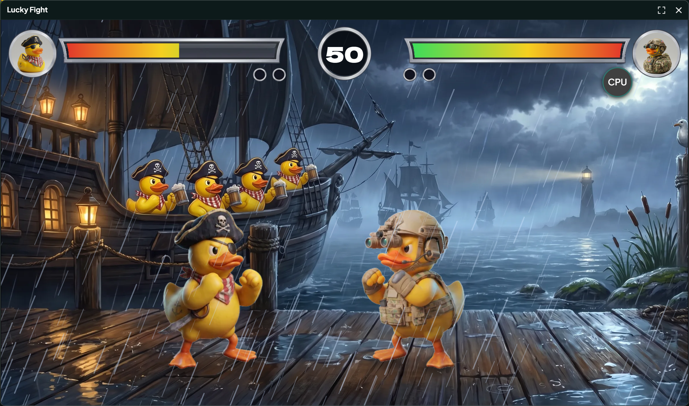<figcaption><p>First to two rounds; when the clock runs out, the duck with more health takes the round.</p></figcaption></figure>



{% column width="30%" %}

<figure>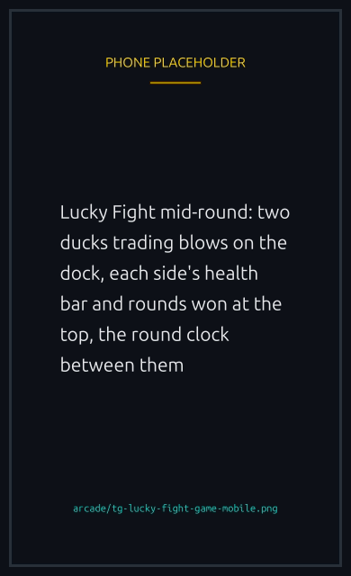<figcaption><p>On a phone</p></figcaption></figure>




To challenge one player from a group, name them: `/fight @their_handle`. The post's **Take the fight** button skips the start screen and pairs you with them alone for the next 10 minutes, or the time the group has set, from 1 minute to an hour; anyone else who taps it plays in an open lobby. If they do not join within the wait, you fight the computer, and they can still join you while you do. You can also open the post again to wait for them once more while it lasts.

When a fight between two players ends, the bot replies under the post you opened it from, over the winner's avatar: who won, and each side's rounds won, damage dealt and score. A challenge's result goes under the challenge itself. Its **Rematch** button challenges the same two players again, and the rematch's result replies under it; the button appears when at least one of you has a Telegram username to be challenged by. Its **Replay** button plays the whole fight again in the app, for anyone in the chat; after a game update that changes how fights play, older replays can no longer be shown. A fight against the computer, or one left in its first seconds, is not posted. Whoever added the bot to a group can switch these posts off for it.

<figure>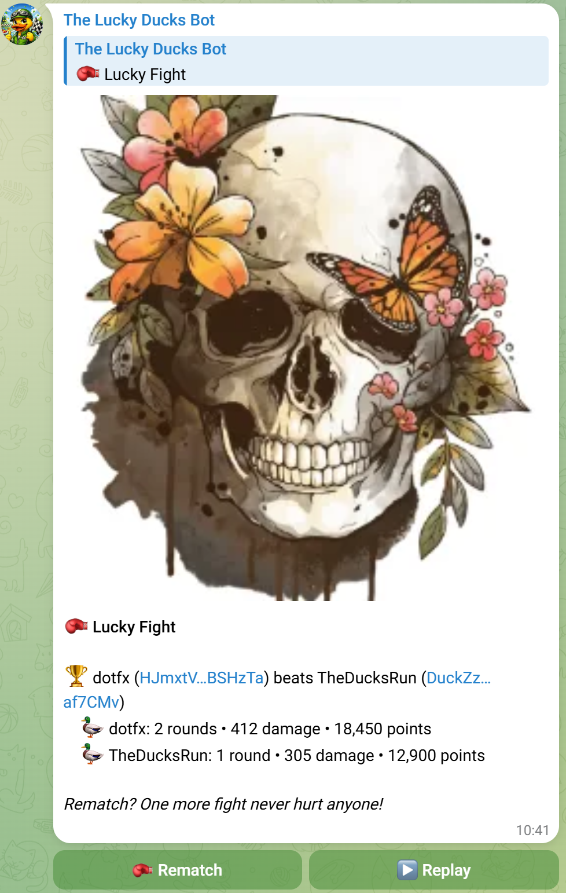<figcaption><p>Posted under the fight's own post, with a rematch and a replay one tap away.</p></figcaption></figure>

## Lucky Squad

<figure>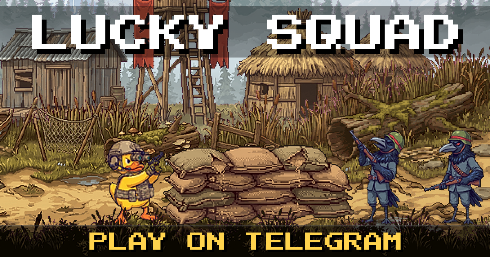<figcaption><p>Lead your duck through the operation and bring down the Heron Walker.</p></figcaption></figure>

Lucky Squad is a side-scrolling run-and-gun: you lead a duck commando through an operation against the Flock. Play it in the arcade on the site, or in Telegram with `/luckysquad`.

Move with the four arrows, and use **Fire**, **Jump**, **Grenade** and **Swap gun**. On a keyboard, Fire is Z or J, Jump is X or K, Grenade is C or L, and Swap gun is S; with a mouse, a left click on the game fires, a right click jumps, a middle click throws a grenade and the wheel swaps your gun. On a phone held sideways, the touch pad and its buttons do the same, the small orange one swapping your gun, and the movement pad stays where you last lifted your thumb. Up close, your duck strikes with its wing.

The operation is Reed Line, one long stage that scrolls from left to right through a run of arenas. The screen stops scrolling until each wave is down, and every arena runs on a clock. Each arena has a flagpole: reaching it tears down the Flock's banner and raises the squad's flag under a **CHECKPOINT** banner. The last arena holds the boss, the Heron Walker, a stocky armoured heron with a pair of cannons on its chest aimed a little down at you, and a spiked bill it lunges a short way ahead. Hurt it from beneath: stand under it and fire up at its three weak points in turn, the cannon mount on its chest, then the saddle on its back, then its head.

- **Lives**: you have three for the operation, and each one is a health bar: a bullet takes one notch, a blast takes more. The bar's last notch is red and blinks, so you can see at a glance when one more hit costs a life. A duck that falls comes back where it fell, blinking and untouchable for two seconds. There are no continues.
- **Weapons**: a pistol that never runs out, and 10 grenades. A weapon crate, the gun it holds painted on its side, gives Rapid (200 shots), Spread (30) or Flame (30, which passes through cover, burning sandbag walls as it goes). You carry the pistol and up to two of these guns, each with its own ammo, up to 999. A crate's gun you already carry adds its ammo; a new one goes in your hand, and with two carried it replaces the one in your hand. An empty gun is dropped and you take your next, else the pistol. Each press of Swap gun steps through your guns, then the pistol. The box beside your health shows the gun in hand over its ammo, ∞ for the pistol, and the grenade over the grenades left. A grenade crate gives 10 more grenades. Two guns never come close together: a gun that would land near another comes as grenades instead.
- **Cover**: sandbag walls cross the lane, and both sides use them. A wall is four rows of bags, a little taller than a duck, so a rifle shot at a duck behind it hits the bags, whichever side you are on. Crouch behind one, or jump: a standing jump lands on top. Bullets, grenades and flame all wear a wall down, row by row, until it is a flat heap that no longer covers or blocks.
- **The Flock**: rifle crows, grenadier crows, magpie sappers that lay mines, black swans, a gun jeep whose driver and gunner can each be shot, a beetle tank, and the Heron Walker. Crows hold the open ground before the sandbag walls, so you fight your way up to each wall, and one you run past is gone without scoring.
- **Rescues**: ducklings wait in cages along the way. Shoot a cage open to free one, and it drops a crate: a weapon, grenades, or a medal box. If your duck has lost a notch, it may drop a health pack instead, which refills your health bar. In a squad, a duckling freed while a teammate has no lives left gives that teammate a life back instead of a crate: their duck flashes gold with 1UP over it, and their new heart pops in.


{% column width="70%" %}

<figure>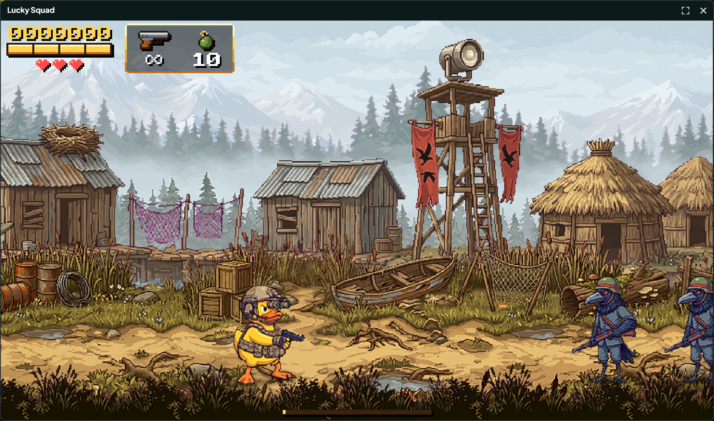<figcaption><p>Hold the wall, clear the wave, and free the duckling for its crate.</p></figcaption></figure>



{% column width="30%" %}

<figure>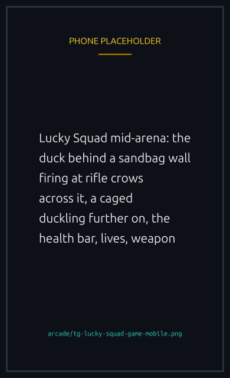<figcaption><p>On a phone</p></figcaption></figure>




What each part of a run scores:

- An enemy soldier, a vehicle's crew included: 100
- The gun jeep: 1,000; the beetle tank: 3,000
- The Heron Walker: 50,000
- A duckling freed: 1,000, and 10,000 for the last one
- A medal: 500
- Clearing the operation: 20,000
- Clearing it without losing a life: 30,000 more

Your device sends a recording of the run, and the server replays it to decide your score, the arenas you cleared and whether you cleared the operation. The board shows each player's best with the arenas it cleared and whether it cleared the operation. **PLAY AGAIN** on the result takes you back to the start screen.

### Playing in a squad

Up to four players can run the operation together. There is no waiting room: **OPEN A SQUAD** starts the operation at once with you alone in it. While a squad can take another player, the start screen shows **JOIN** in **OPEN A SQUAD**'s place, with that squad's players' avatars inside it. A player who joins a squad already playing drops in as soon as their device has loaded the stage: their duck falls in from the top of the screen over the leading duck, blinking as a duck does after a fall.

<figure>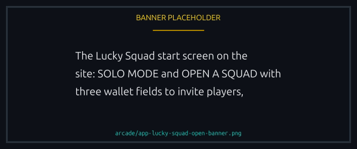<figcaption><p>Empty seats are open to anyone. Name a wallet to keep its seat for that player, or pick No player to lock it.</p></figcaption></figure>

- **OPEN A SQUAD**, on the site and in Telegram, opens its own screen in the game, with **OPEN** and **BACK**, asking for up to three players to invite, all optional. You stand first, shown as the boards show a player: your avatar, nickname and shortened wallet. The three fields to invite follow. Once you have typed two characters, each field suggests players whose wallet starts with them or whose nickname holds them, and picking one turns the field into the same kind of badge, with a small button to remove them and get the empty field back. A field also takes a Telegram @handle: a handle whose Telegram account is verified to a wallet shows that player's avatar and keeps the seat for them, and any other shows the Telegram logo and keeps the seat for whoever joins from Telegram with that @username. No one can be named twice: a repeat, or your own wallet or handle, turns its field red, and **OPEN** stays off until it is fixed. Each player you name keeps a seat for them until they take it, and the seats left empty are open to anyone: name one player, and two seats are open to anyone and one is kept for that player. While an open seat is free, everyone is offered the squad as a **JOIN** button, players in Telegram included, and a player you named is offered it while their kept seat is free. Name three players and every seat is kept, so only those players are offered the squad and can join it. A seat can also be locked: **No player** is the first choice in its suggestions, and a locked seat shows a padlock with a button to open it again. Each locked seat makes the squad one seat smaller, so a squad holds 2, 3 or 4 players, and locking all three starts a solo run.
- **In Telegram**, `/luckysquad` posts a card anyone can play from: the first tap opens a squad, the next three join it, the fifth opens a new squad, and so on. `/luckysquad @handle`, naming one to three players, posts a card only you and the players you named can open: the first of you in starts the operation, and the others drop in. A card's link lasts as long as a `/fight @handle` challenge does in that group.
- **Turned away**: a card's link that has expired or is not valid, a squad that names other players, or online lobbies that are all taken (see [Where to play](#where-to-play)). Each time the game says why, and you can still play solo.
- **Who is who**: each player has a colour of their own, by their place in the squad: cyan, pink, green and purple, the same on every phone. Their nickname stands over their duck in it, and it rings their avatar at the top right of the screen, on the **JOIN** button and on the result.
- **Dropping out**: each phone plays its own duck at once, so a slow one does not hold the squad back. A player whose connection drops, or whose phone stops sending moves for about a second, is greyed out and moved to the end of the avatars, and has 5 seconds to come back, their duck standing still and untouchable meanwhile. After that their duck leaves the operation, keeping its score but not the clear bonus, and the run goes on for the others.
- **Scoring**: each player scores their own kills, rescues and pickups, and the result shows each player's score with their avatar in front of it, P1 to P4 for a player with no picture. Each player's own score counts on their own best, XP and badges.

## Lucky Flaps

<figure>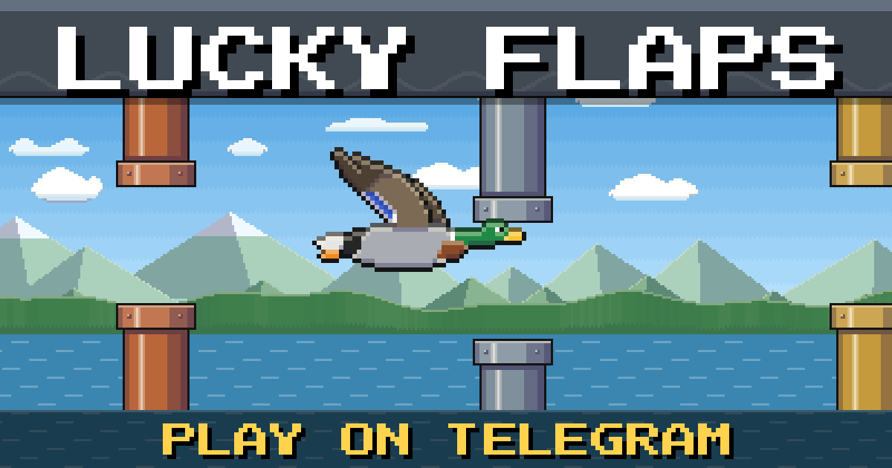<figcaption><p>Flap through the pipes, stage after stage.</p></figcaption></figure>

Tap or click to flap, or on a keyboard press Space, Up, W, Enter or Ctrl, and fly your duck through the openings between the pipes. Each pipe you pass scores, each coin you take scores more, and each stage you finish more again. The stages get faster and their openings narrower as you go. Touching a pipe, the ground or the top of the screen ends the run.

**The first two stages are clear, and from the third every stage has its weather**, starting with rain. The banner that opens a stage names its weather, so you know what is coming. Rain and snow weigh your duck down, so it sinks faster between flaps. A storm brings the rain with thunder and lightning flashing behind the course. Fog drifts through the pipes, so the next one shows late.

<figure>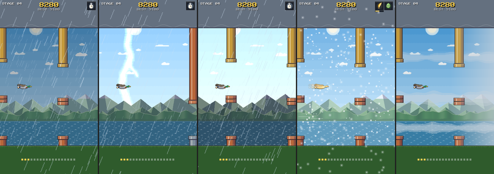<figcaption><p>Rain and snow make your duck heavier. Fog hides what is coming.</p></figcaption></figure>

**From the fourth stage, gold carp leap out of the marsh** between two gates: 2 in the fourth stage, 3 in the fifth, 4 in the sixth, and one more in each stage after that, up to 6. A splash shows where each leaves the water and where it drops back. A fish tops its leap just as your duck reaches it, a little above the bottom of the openings, so a duck skimming low between the gates is caught and one keeping high flies over. Touching a fish ends the run like a pipe: the pocket watch saves you from it as from any crash, and the Lucky Rush flies straight through.

<figure>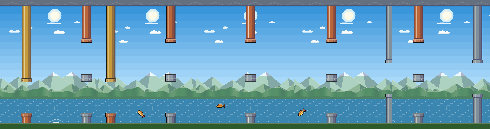<figcaption><p>The fish tops its leap as you reach it: keep high between the gates to clear it.</p></figcaption></figure>

**Every stage has three coins**, each inside a gate's opening, and a coin is worth more in each later stage. In the first stage they sit in the middle of the opening, and each stage after moves them closer to the edge of the top or bottom pipe, until from the sixth they sit just off the pipe.

**From the second stage, power-ups float between the pipes.** Fly into one to take it. The second stage has the golden feather; from the third, every stage has both the feather and the pocket watch, each in a gap of its own.

- **The golden feather** sets off the Lucky Rush at once: for 10 seconds the course runs at twice the speed, and a pipe you fly into is smashed instead of ending your run, paying extra once per gate. The ground and the top of the screen still end it. Only the pipe you hit breaks: the other pipe of its gate stays, and still ends a run that hits it once the Rush is over.
- **The pocket watch** waits until you crash, then puts your run back one second, so you fly that stretch again. You carry one at a time. The Rush comes first: you can take a watch during a Rush, and it waits in your slot until the Rush is over, so a crash into the ground or the top of the screen in the Rush still ends your run, and the watch saves the first crash after it.

**Everyone flies the same course each day.** It changes at 00:00 UTC. The board ranks everyone's best ever, whichever day it was flown, and that best is also what the badges count.

**Flock mode**: the start screen offers **SOLO MODE** to fly alone, **OPEN TO THE FLOCK** to open your run to other players, and **JOIN THE FLOCK** to join one. Up to 32 ducks fly the course together, each with its player's avatar over it, and yours sits beside the stage progress. The whole flock gets the same 3, 2, 1, so the ducks take off together. A duck that joins later appears beside whichever duck is furthest along, safe for a moment while it finds its wings. Ducks fly through each other, but a golden feather's Rush sends out a shockwave that knocks nearby ducks down, so taking one can cost the flock around you. The watch acts on your own duck alone.

<figure>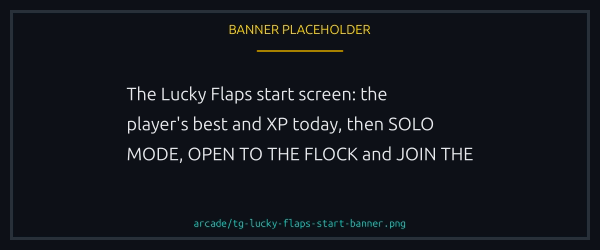<figcaption><p>Fly alone, open your run to the flock, or join one already in the air.</p></figcaption></figure>

## Lucky Shot

<figure>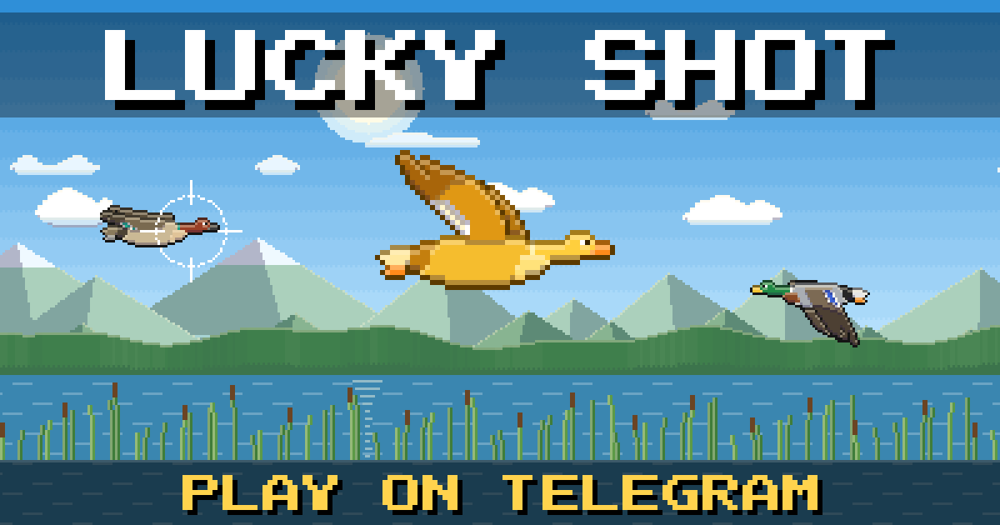<figcaption><p>Shoot the ducks before the clock runs out.</p></figcaption></figure>

Ducks take off from the marsh, and you tap one to shoot it. Each round sends ten ducks, one or two at a time, and every pair or single gives you three shots before they fly off. The ducks fly faster with each one a round sends, and the next round starts calmer before it climbs again. Each round also has a clock at the top of the screen: when it runs out, the ducks still in the air fly off and any not yet sent count as missed, so letting ducks get away costs you time as well as hits. From the fourth round, distant flocks of birds cross the sky, and from the seventh a frog leaps out of the reeds: they are only there to catch your eye, and a shot at one is simply a miss. Catch two ducks as they cross and one shot brings down both, a double hit that pays for each. Hit enough of the round's ducks to clear it; the first round you fall short ends the run. Mallards are the easy ones, teal fly faster and pay double, and the rare golden duck is the fastest and pays five times a mallard. Every hit is worth more the further you get, and hitting all ten in a round pays a bonus.


{% column width="70%" %}

<figure>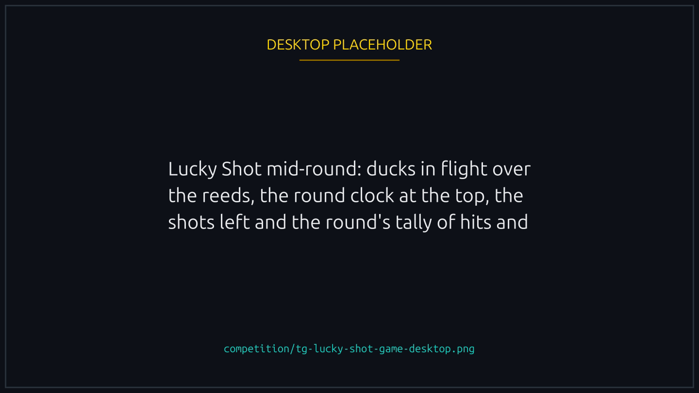<figcaption><p>Three shots for each duck or pair, and a clock that keeps running while they fly.</p></figcaption></figure>



{% column width="30%" %}

<figure>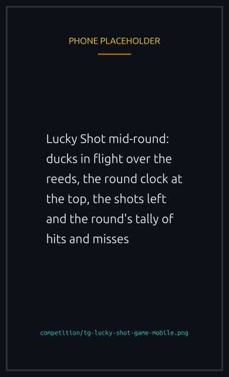<figcaption><p>On a phone</p></figcaption></figure>




<figure>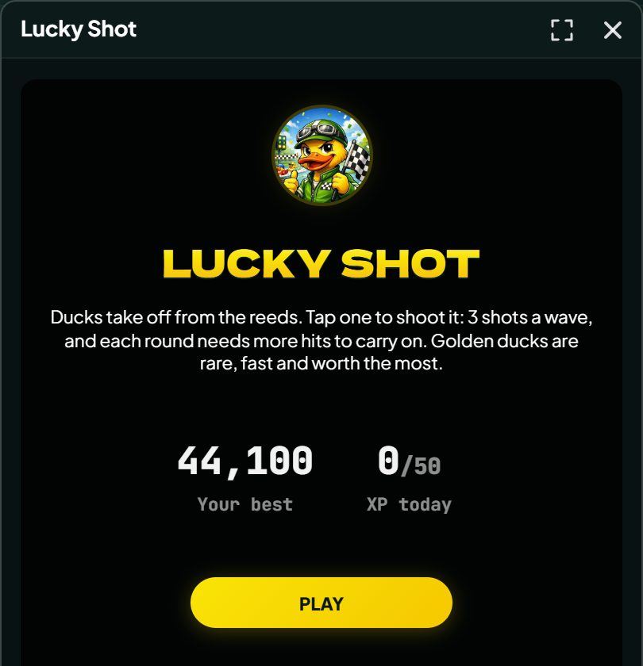<figcaption><p>Your best and today's XP appear only once your Telegram account is linked to a wallet.</p></figcaption></figure>

## Lucky Dodge

<figure>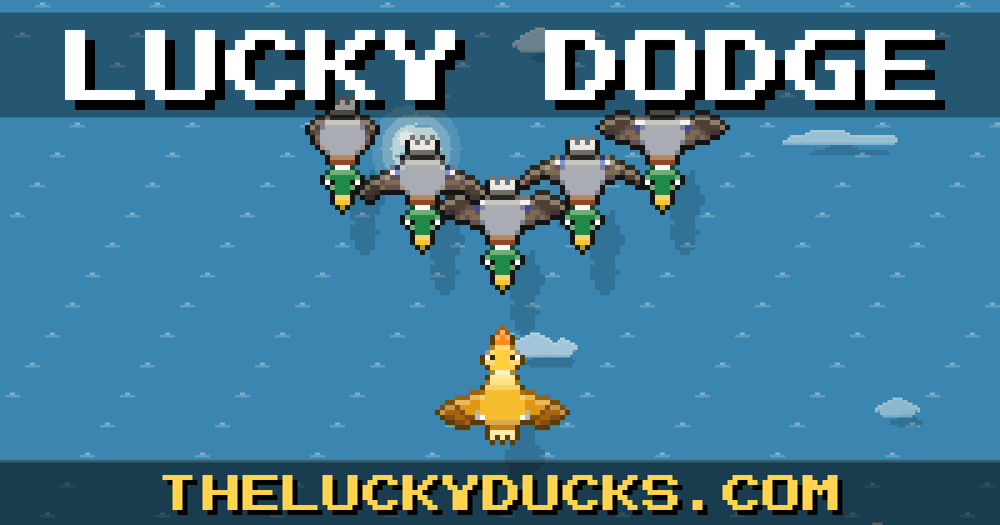<figcaption><p>Dodge the falling flock for as long as you can.</p></figcaption></figure>

You look straight down from high above the marsh's open water, and mallards fly at your golden duck: alone, in pairs, in V formations, in diagonals and in walls. Steer clear of them for as long as you can. On a touch screen, touch the lower part of the screen and a dial appears there, staying where you last used it and fading while you leave it be: push its knob left or right to move, and flick it twice the same way to dash to that edge. You start with a few lives, shown as hearts under the level, a hit costs one, and the run ends when they are gone.

<figure>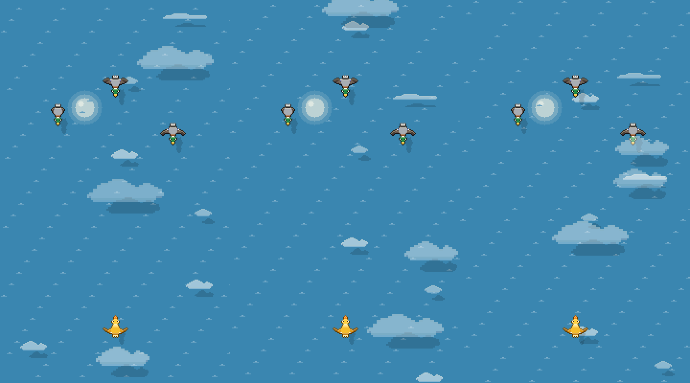<figcaption><p>The flock flies high: clouds drift above and below it, and the shadows fall far beneath.</p></figcaption></figure>

The game climbs level by level. The first two levels are short, so you are soon in the game proper, and each level after them is a little faster and denser. The levels never run out: past the last named one they keep coming, each faster and thicker again up to a pace that stays readable, so the board is decided by how far you get. A lone duck can come at any level, so no level is one you can stand still in. A duck takes as long to cross a tall phone screen as a short desktop panel, so the shared board is fair whatever you play on.

Your score counts on the game's board and toward its badges, and each level you clear pays XP.

## Leaderboards

Each game has one leaderboard, the same on the site and in Telegram, so a run counts wherever you play it. Your best run is your place on it.

You can play in Telegram before linking a wallet. Your runs then rank under your Telegram account, marked with a **TG** badge, and when you link a wallet your best moves to it, the better of the two kept if the wallet already had one. See [Player verification](../trust/verification.md).

## XP and badges

XP and badges go to a wallet, so in Telegram they need your account linked to one. Each game pays XP up to 50 a day, counted from 00:00 UTC:

- **Lucky Fight**: 3 XP for finishing a fight, 7 more for winning it, and 3 for each round you win at full health. A fight that ends in its first seconds pays nothing.
- **Lucky Squad**: 5 XP for each arena you clear, the boss's arena once the Heron Walker is down.
- **Lucky Flaps**: 5 XP for each stage you clear.
- **Lucky Shot**: 5 XP for each round you clear.
- **Lucky Dodge**: 5 XP for each level you clear.

Each game has three badges: your best score earns them in Lucky Squad, Lucky Flaps, Lucky Shot and Lucky Dodge, and the fights you win in Lucky Fight. See [Badges](../competition/badges.md#arcade).

## Sharing a run

When a run ends, the share button, a round disc on the top right corner of the score plate, posts your score with a link to the game: on a phone it opens your phone's share menu, and otherwise you pick X, Telegram or copying the link. The link shows the game's card in the post, and a phone's share menu attaches the card animated. Whoever opens the link lands in the game.



```
theluckyducks.com/arcade/luckyfight
theluckyducks.com/arcade/luckysquad
theluckyducks.com/arcade/luckyflaps
theluckyducks.com/arcade/luckyshot
theluckyducks.com/arcade/luckydodge
```


