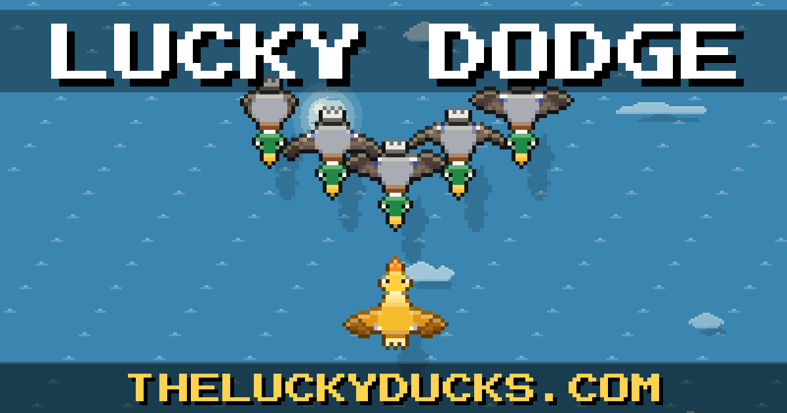
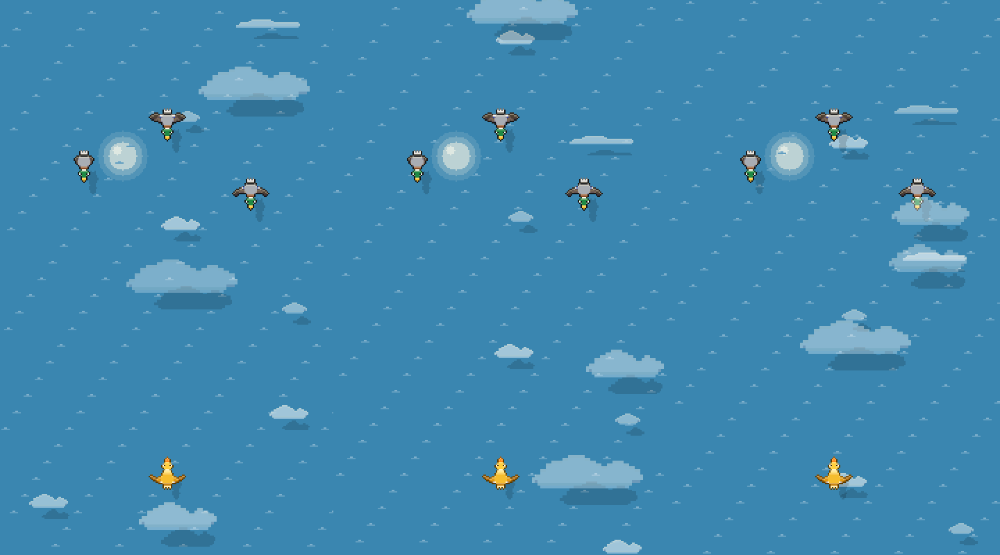

# Lucky Dodge

<figure><figcaption>
Dodge the falling flock for as long as you can.
</figcaption></figure>

You look straight down from high above the marsh's open water, and mallards fly at your golden duck: alone, in pairs, in V formations, in diagonals and in walls. Steer clear of them for as long as you can. On a touch screen, touch the lower part of the screen and a dial appears there, staying where you last used it and fading while you leave it be: push its knob left or right to move, and flick it twice the same way to dash to that edge. You start with a few lives, shown as hearts under the level, a hit costs one, and the run ends when they are gone.

<figure><figcaption>
The flock flies high: clouds drift above and below it, and the shadows fall far beneath.
</figcaption></figure>

The game climbs level by level. The first two levels are short, so you are soon in the game proper, and each level after them is a little faster and denser. The levels never run out: past the last named one they keep coming, each faster and thicker again up to a pace that stays readable, so the board is decided by how far you get. A lone duck can come at any level, so no level is one you can stand still in. A duck takes as long to cross a tall phone screen as a short desktop panel, so the shared board is fair whatever you play on.

Your score counts on the game's board and toward its badges, and each level you clear pays XP.
