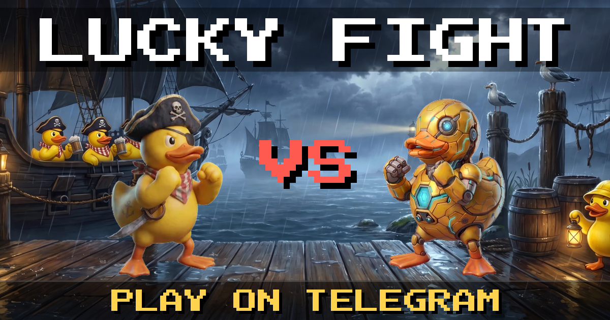
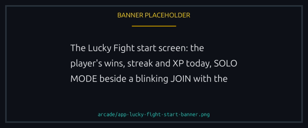
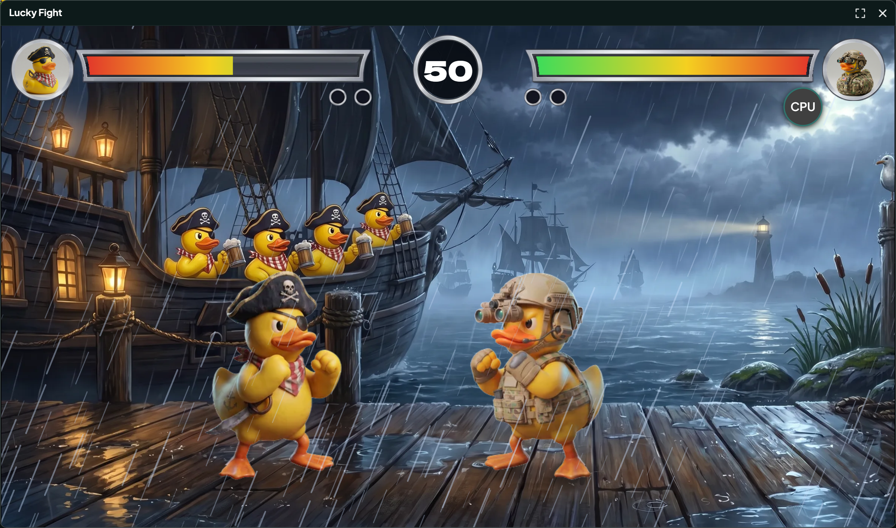
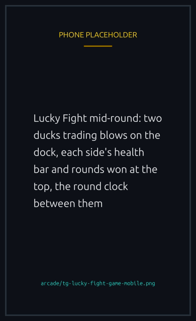
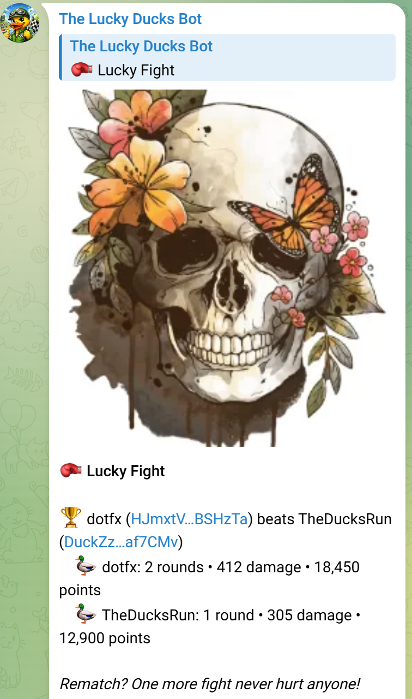

# Lucky Fight

<figure><figcaption>
Pick a duck and fight, live.
</figcaption></figure>

`/luckyfight`, or `/fight`, posts the game with a **Play Lucky Fight** button that opens it inside Telegram, over the whole screen. While the game's art downloads, a loading screen shows its title over a gold ring and the file it is loading, with a button to try again if a download fails.

Lucky Fight opens on a start screen, on the site as in Telegram: your wins, your streak and the XP you have earned today, the board, and the ways to fight.

- **SOLO MODE** fights the computer at once, with no wait.
- **OPEN A CHALLENGE** asks whom the challenge is for, in one field: a wallet, a player's nickname picked from the suggestions, or a Telegram @handle. **Anyone**, offered first, opens it to whoever comes. **OPEN** then waits for your challenger.
- **JOIN** blinks in **OPEN A CHALLENGE**'s place, with the challenger's avatar inside, when a challenge names you or someone is waiting for a fight, and pairs you with them.

<figure><figcaption>
Fight the computer at once, open a challenge, or take the one waiting for you.
</figcaption></figure>

A challenge naming a player can be taken only by that player, matched by their wallet or by the Telegram handle their account is linked to, and one named by @handle only from Telegram. You never fight your own account.

Online, once your duck is ready it waits for your opponent's. Pick a duck and fight another player, live: punch, kick and land specials, and the first to win two rounds takes the fight. Each round has a 60 second clock, and when it runs out the duck with more health left wins the round. If nobody takes your challenge, you fight the computer instead: the wait is 60 seconds unless the group the post came from has set another, from 10 seconds to 2 minutes. You stay in the queue while you fight the computer, so a player who joins then still reaches you: the fight against the computer stops, it counts for nothing, and you both go on to pick your ducks. Play on a keyboard or on a phone: held upright the fight sits between black bands, and turned sideways it fills the screen. On a phone the movement pad stays, faint, where your thumb last lifted.

**On the site**, Lucky Fight pairs you only with players in the same lobby: your team's chat opens your team's, and a race lounge's chat that race's. Only players on the site meet there, but a challenge you name for a player reaches them wherever they open Lucky Fight, Telegram included. While someone is waiting for a fight in that lobby, the game's button in the arcade says so, and **JOIN** pairs you with them. If nobody comes within 60 seconds, you fight the computer, and a player who arrives then still reaches you, as in Telegram. A lounge's spectator, who is not in the race, sees Lucky Fight switched off. A fight on the site counts on the same board and pays the same XP and badges, but is not posted in any chat.


{% column width="70%" %}

<figure><figcaption>
First to two rounds; when the clock runs out, the duck with more health takes the round.
</figcaption></figure>



{% column width="30%" %}

<figure><figcaption>
On a phone
</figcaption></figure>




To challenge one player from a group, name them: `/fight @their_handle`. The post's **Take the fight** button skips the start screen and pairs you with them alone for the next 10 minutes, or the time the group has set, from 1 minute to an hour; anyone else who taps it plays in an open lobby. If they do not join within the wait, you fight the computer, and they can still join you while you do. You can also open the post again to wait for them once more while it lasts.

When a fight between two players ends, the bot replies under the post you opened it from, over the winner's avatar: who won, and each side's rounds won, damage dealt and score. A challenge's result goes under the challenge itself. Its **Rematch** button challenges the same two players again, and the rematch's result replies under it; the button appears when at least one of you has a Telegram username to be challenged by. Its **Replay** button plays the whole fight again in the app, for anyone in the chat; after a game update that changes how fights play, older replays can no longer be shown. A fight against the computer, or one left in its first seconds, is not posted. Whoever added the bot to a group can switch these posts off for it.

<figure><figcaption>
Posted under the fight's own post, with a rematch and a replay one tap away.
</figcaption></figure>
