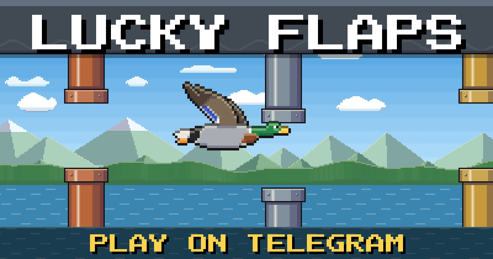
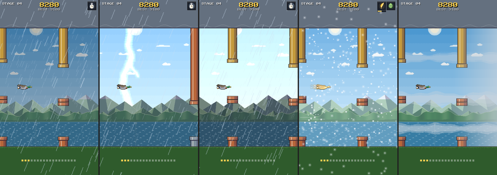
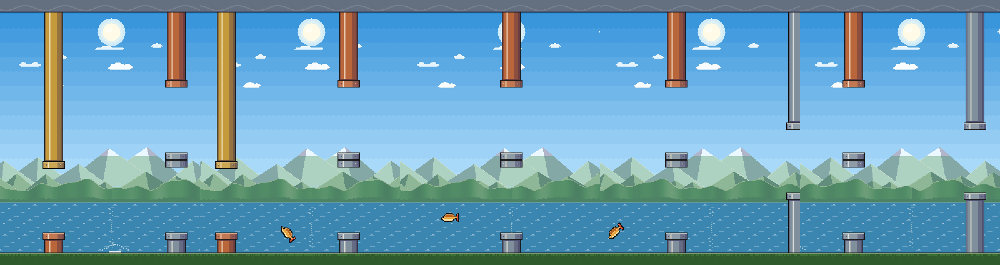
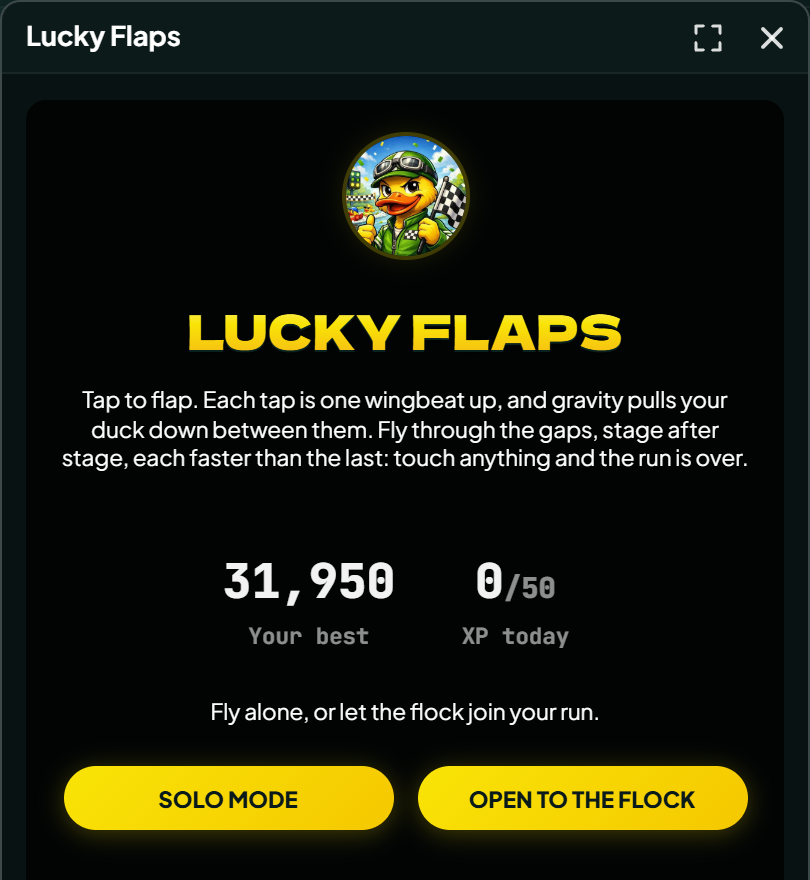

# Lucky Flaps

<figure><figcaption>
Flap through the pipes, stage after stage.
</figcaption></figure>

Tap or click to flap, or on a keyboard press Space, Up, W, Enter or Ctrl, and fly your duck through the openings between the pipes. Each pipe you pass scores, each coin you take scores more, and each stage you finish more again. The stages get faster and their openings narrower as you go. Touching a pipe, the ground or the top of the screen ends the run.

**The first two stages are clear, and from the third every stage has its weather**, starting with rain. The banner that opens a stage names its weather, so you know what is coming. Rain and snow weigh your duck down, so it sinks faster between flaps. A storm brings the rain with thunder and lightning flashing behind the course. Fog drifts through the pipes, so the next one shows late.

<figure><figcaption>
Rain and snow make your duck heavier. Fog hides what is coming.
</figcaption></figure>

**From the fourth stage, gold carp leap out of the marsh** between two gates: 2 in the fourth stage, 3 in the fifth, 4 in the sixth, and one more in each stage after that, up to 6. A splash shows where each leaves the water and where it drops back. A fish tops its leap just as your duck reaches it, a little above the bottom of the openings, so a duck skimming low between the gates is caught and one keeping high flies over. Touching a fish ends the run like a pipe: the pocket watch saves you from it as from any crash, and the Lucky Rush flies straight through.

<figure><figcaption>
The fish tops its leap as you reach it: keep high between the gates to clear it.
</figcaption></figure>

**Every stage has three coins**, each inside a gate's opening, and a coin is worth more in each later stage. In the first stage they sit in the middle of the opening, and each stage after moves them closer to the edge of the top or bottom pipe, until from the sixth they sit just off the pipe.

**From the second stage, power-ups float between the pipes.** Fly into one to take it. The second stage has the golden feather; from the third, every stage has both the feather and the pocket watch, each in a gap of its own.

- **The golden feather** sets off the Lucky Rush at once: for 10 seconds the course runs at twice the speed, and a pipe you fly into is smashed instead of ending your run, paying extra once per gate. The ground and the top of the screen still end it. Only the pipe you hit breaks: the other pipe of its gate stays, and still ends a run that hits it once the Rush is over.
- **The pocket watch** waits until you crash, then puts your run back one second, so you fly that stretch again. You carry one at a time. The Rush comes first: you can take a watch during a Rush, and it waits in your slot until the Rush is over, so a crash into the ground or the top of the screen in the Rush still ends your run, and the watch saves the first crash after it.

**Everyone flies the same course each day.** It changes at 00:00 UTC. The board ranks everyone's best ever, whichever day it was flown, and that best is also what the badges count.

**Flock mode**: the start screen offers **SOLO MODE** to fly alone, **OPEN TO THE FLOCK** to open your run to other players, and **JOIN THE FLOCK** to join one. Up to 32 ducks fly the course together, each with its player's avatar over it, and yours sits beside the stage progress. The whole flock gets the same 3, 2, 1, so the ducks take off together. A duck that joins later appears beside whichever duck is furthest along, safe for a moment while it finds its wings. Ducks fly through each other, but a golden feather's Rush sends out a shockwave that knocks nearby ducks down, so taking one can cost the flock around you. The watch acts on your own duck alone.

<figure><figcaption>
Fly alone, open your run to the flock, or join one already in the air.
</figcaption></figure>
