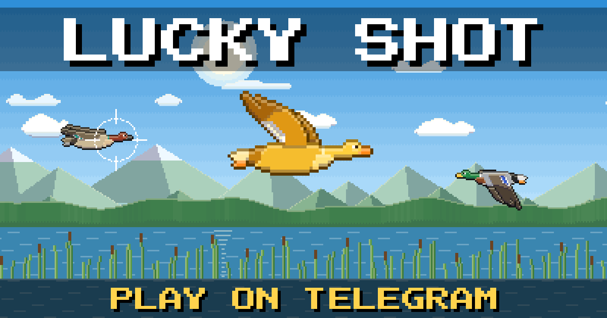
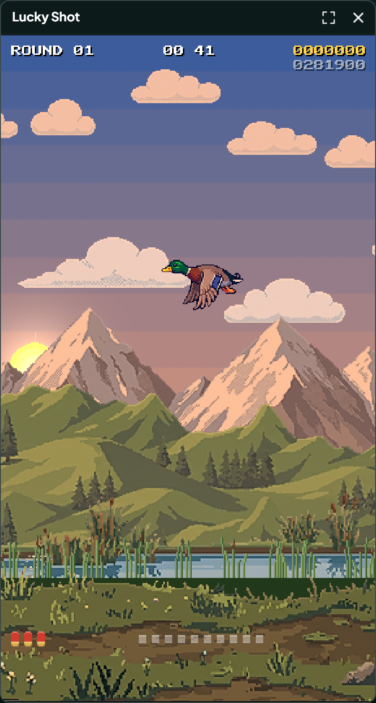
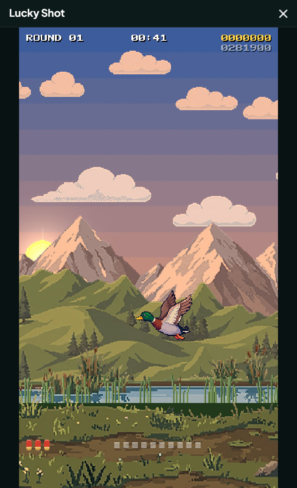
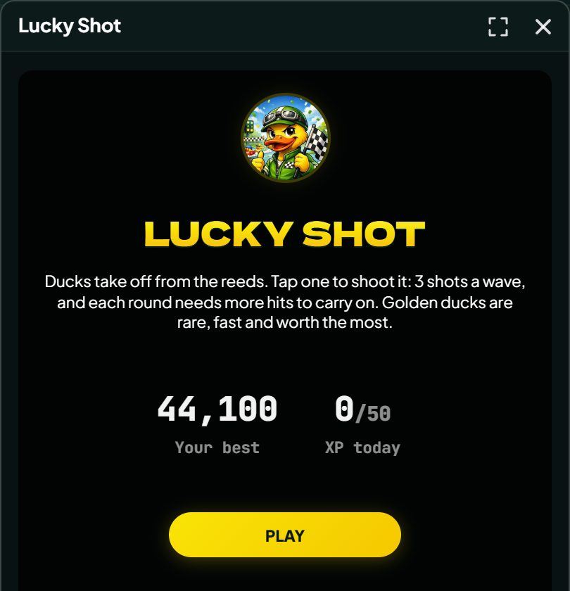

# Lucky Shot

<figure><figcaption>
Shoot the ducks before the clock runs out.
</figcaption></figure>

Ducks take off from the marsh, and you tap one to shoot it. Each round sends ten ducks, one or two at a time, and every pair or single gives you three shots before they fly off. The ducks fly faster with each one a round sends, and the next round starts calmer before it climbs again. Each round also has a clock at the top of the screen: when it runs out, the ducks still in the air fly off and any not yet sent count as missed, so letting ducks get away costs you time as well as hits. From the fourth round, distant flocks of birds cross the sky, and from the seventh a frog leaps out of the reeds: they are only there to catch your eye, and a shot at one is simply a miss. Catch two ducks as they cross and one shot brings down both, a double hit that pays for each. Hit enough of the round's ducks to clear it; the first round you fall short ends the run. Mallards are the easy ones, teal fly faster and pay double, and the rare golden duck is the fastest and pays five times a mallard. Every hit is worth more the further you get, and hitting all ten in a round pays a bonus.


{% column width="70%" %}

<figure><figcaption>
Three shots for each duck or pair, and a clock that keeps running while they fly.
</figcaption></figure>



{% column width="30%" %}

<figure><figcaption>
On a phone
</figcaption></figure>




<figure><figcaption>
Your best and today's XP appear only once your Telegram account is linked to a wallet.
</figcaption></figure>
