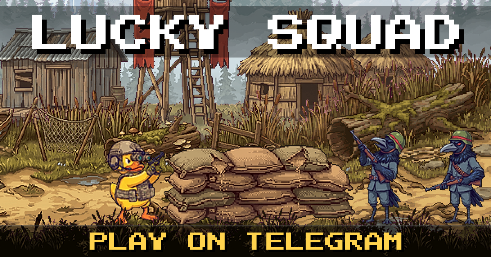
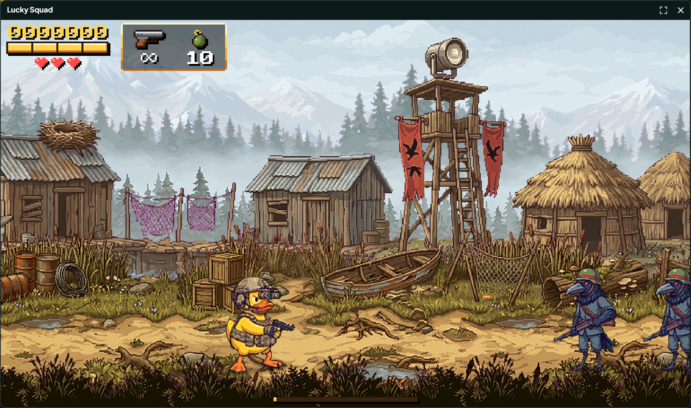
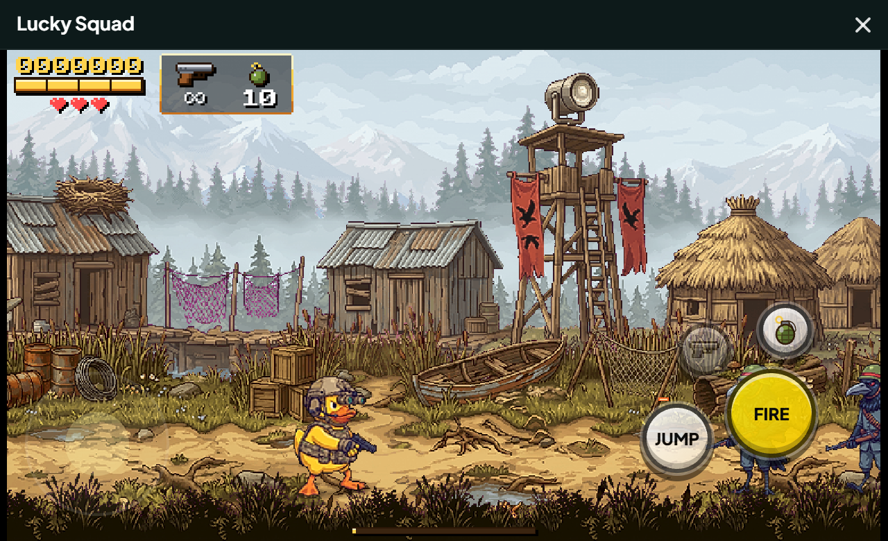
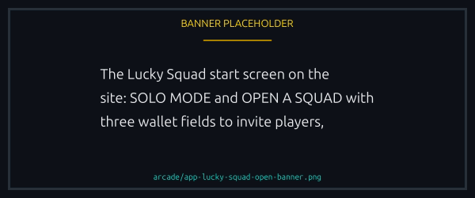

# Lucky Squad

<figure><figcaption>
Lead your duck through the operation and bring down the Heron Walker.
</figcaption></figure>

Lucky Squad is a side-scrolling run-and-gun: you lead a duck commando through an operation against the Flock. Play it in the arcade on the site, or in Telegram with `/luckysquad`.

Move with the four arrows, and use **Fire**, **Jump**, **Grenade** and **Swap gun**. On a keyboard, Fire is Z or J, Jump is X or K, Grenade is C or L, and Swap gun is S; with a mouse, a left click on the game fires, a right click jumps, a middle click throws a grenade and the wheel swaps your gun. On a phone held sideways, the touch pad and its buttons do the same, the small orange one swapping your gun, and the movement pad stays where you last lifted your thumb. Up close, your duck strikes with its wing.

The operation is Reed Line, one long stage that scrolls from left to right through a run of arenas. The screen stops scrolling until each wave is down, and every arena runs on a clock. Each arena has a flagpole: reaching it tears down the Flock's banner and raises the squad's flag under a **CHECKPOINT** banner. The last arena holds the boss, the Heron Walker, a stocky armoured heron with a pair of cannons on its chest aimed a little down at you, and a spiked bill it lunges a short way ahead. Hurt it from beneath: stand under it and fire up at its three weak points in turn, the cannon mount on its chest, then the saddle on its back, then its head.

- **Lives**: you have three for the operation, and each one is a health bar: a bullet takes one notch, a blast takes more. The bar's last notch is red and blinks, so you can see at a glance when one more hit costs a life. A duck that falls comes back where it fell, blinking and untouchable for two seconds. There are no continues.
- **Weapons**: a pistol that never runs out, and 10 grenades. A weapon crate, the gun it holds painted on its side, gives Rapid (200 shots), Spread (30) or Flame (30, which passes through cover, burning sandbag walls as it goes). You carry the pistol and up to two of these guns, each with its own ammo, up to 999. A crate's gun you already carry adds its ammo; a new one goes in your hand, and with two carried it replaces the one in your hand. An empty gun is dropped and you take your next, else the pistol. Each press of Swap gun steps through your guns, then the pistol. The box beside your health shows the gun in hand over its ammo, ∞ for the pistol, and the grenade over the grenades left. A grenade crate gives 10 more grenades. Two guns never come close together: a gun that would land near another comes as grenades instead.
- **Cover**: sandbag walls cross the lane, and both sides use them. A wall is four rows of bags, a little taller than a duck, so a rifle shot at a duck behind it hits the bags, whichever side you are on. Crouch behind one, or jump: a standing jump lands on top. Bullets, grenades and flame all wear a wall down, row by row, until it is a flat heap that no longer covers or blocks.
- **The Flock**: rifle crows, grenadier crows, magpie sappers that lay mines, black swans, a gun jeep whose driver and gunner can each be shot, a beetle tank, and the Heron Walker. Crows hold the open ground before the sandbag walls, so you fight your way up to each wall, and one you run past is gone without scoring.
- **Rescues**: ducklings wait in cages along the way. Shoot a cage open to free one, and it drops a crate: a weapon, grenades, or a medal box. If your duck has lost a notch, it may drop a health pack instead, which refills your health bar. In a squad, a duckling freed while a teammate has no lives left gives that teammate a life back instead of a crate: their duck flashes gold with 1UP over it, and their new heart pops in.


{% column width="70%" %}

<figure><figcaption>
Walk into an arena and the Flock is waiting for you.
</figcaption></figure>



{% column width="30%" %}

<figure><figcaption>
On a phone
</figcaption></figure>




What each part of a run scores:

- An enemy soldier, a vehicle's crew included: 100
- The gun jeep: 1,000; the beetle tank: 3,000
- The Heron Walker: 50,000
- A duckling freed: 1,000, and 10,000 for the last one
- A medal: 500
- Clearing the operation: 20,000
- Clearing it without losing a life: 30,000 more

Your device sends a recording of the run, and the server replays it to decide your score, the arenas you cleared and whether you cleared the operation. The board shows each player's best with the arenas it cleared and whether it cleared the operation. **PLAY AGAIN** on the result takes you back to the start screen.

## Playing in a squad

Up to four players can run the operation together. There is no waiting room: **OPEN A SQUAD** starts the operation at once with you alone in it. While a squad can take another player, the start screen shows **JOIN** in **OPEN A SQUAD**'s place, with that squad's players' avatars inside it. A player who joins a squad already playing drops in as soon as their device has loaded the stage: their duck falls in from the top of the screen over the leading duck, blinking as a duck does after a fall.

<figure><figcaption>
Empty seats are open to anyone. Name a wallet to keep its seat for that player, or pick No player to lock it.
</figcaption></figure>

- **OPEN A SQUAD**, on the site and in Telegram, opens its own screen in the game, with **OPEN** and **BACK**, asking for up to three players to invite, all optional. You stand first, shown as the boards show a player: your avatar, nickname and shortened wallet. The three fields to invite follow. Once you have typed two characters, each field suggests players whose wallet starts with them or whose nickname holds them, and picking one turns the field into the same kind of badge, with a small button to remove them and get the empty field back. A field also takes a Telegram @handle: a handle whose Telegram account is verified to a wallet shows that player's avatar and keeps the seat for them, and any other shows the Telegram logo and keeps the seat for whoever joins from Telegram with that @username. No one can be named twice: a repeat, or your own wallet or handle, turns its field red, and **OPEN** stays off until it is fixed. Each player you name keeps a seat for them until they take it, and the seats left empty are open to anyone: name one player, and two seats are open to anyone and one is kept for that player. While an open seat is free, everyone is offered the squad as a **JOIN** button, players in Telegram included, and a player you named is offered it while their kept seat is free. Name three players and every seat is kept, so only those players are offered the squad and can join it. A seat can also be locked: **No player** is the first choice in its suggestions, and a locked seat shows a padlock with a button to open it again. Each locked seat makes the squad one seat smaller, so a squad holds 2, 3 or 4 players, and locking all three starts a solo run.
- **In Telegram**, `/luckysquad` posts a card anyone can play from: the first tap opens a squad, the next three join it, the fifth opens a new squad, and so on. `/luckysquad @handle`, naming one to three players, posts a card only you and the players you named can open: the first of you in starts the operation, and the others drop in. A card's link lasts as long as a `/fight @handle` challenge does in that group.
- **Turned away**: a card's link that has expired or is not valid, a squad that names other players, or online lobbies that are all taken (see [Where to play](README.md#where-to-play)). Each time the game says why, and you can still play solo.
- **Who is who**: each player has a colour of their own, by their place in the squad: cyan, pink, green and purple, the same on every phone. Their nickname stands over their duck in it, and it rings their avatar at the top right of the screen, on the **JOIN** button and on the result.
- **Dropping out**: each phone plays its own duck at once, so a slow one does not hold the squad back. A player whose connection drops, or whose phone stops sending moves for about a second, is greyed out and moved to the end of the avatars, and has 5 seconds to come back, their duck standing still and untouchable meanwhile. After that their duck leaves the operation, keeping its score but not the clear bonus, and the run goes on for the others.
- **Scoring**: each player scores their own kills, rescues and pickups, and the result shows each player's score with their avatar in front of it, P1 to P4 for a player with no picture. Each player's own score counts on their own best, XP and badges.
