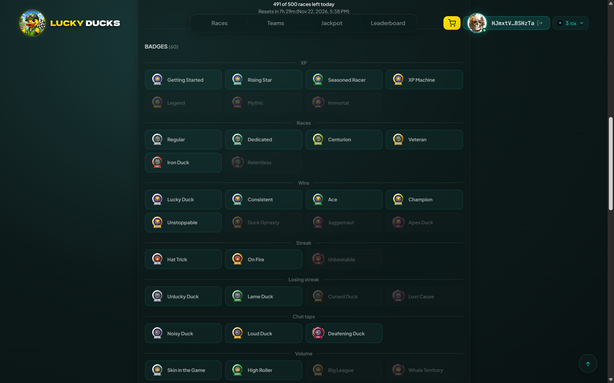
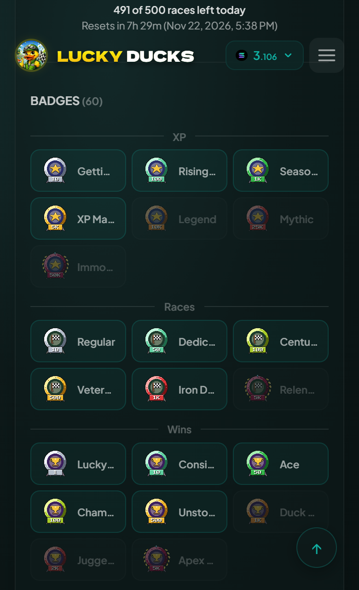
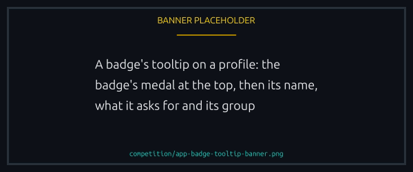
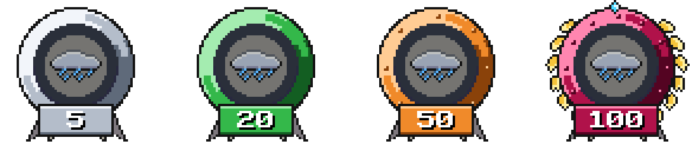
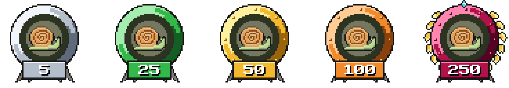
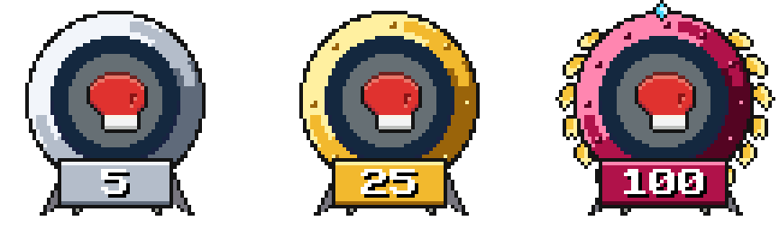
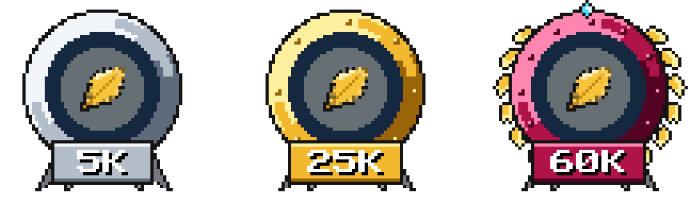
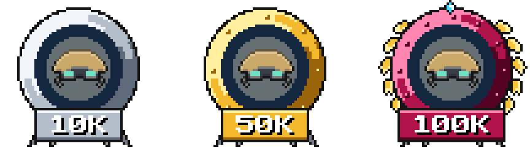
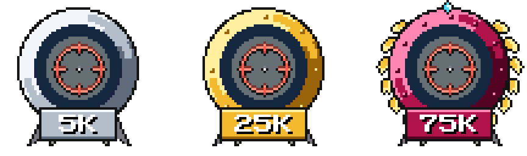
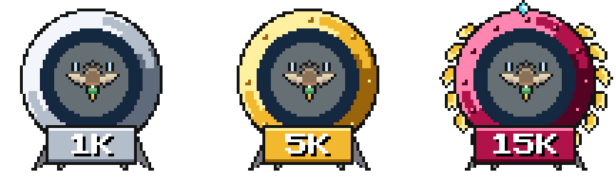

# Badges

Badges arrive on their own as you play and engage, showing on your profile and popping up in Telegram and on the site the moment you unlock one.

Each badge has its own pixel-art medal: your profile and the notice on the site show it, and the Telegram post shows it beside your avatar. The metal of its rim tells how far up its ladder a badge sits, from silver on the first step, warming with each step, to a crimson crystal crowned with a diamond on the last. Hover over a badge on a profile, or tap it, to see its medal with its name, what it asks for and its group. The emoji in the tables below stands in for it wherever the picture cannot load.


They are recognition, nothing more. No badge gives any race advantage.



{% column width="70%" %}

<figure><figcaption>
Unlocked badges sit on your profile. Locked ones stay visible as targets.
</figcaption></figure>


{% column width="30%" %}

<figure><figcaption>
On a phone
</figcaption></figure>



<figure><figcaption>
Hover over a badge, or tap it, to see what it asks for.
</figcaption></figure>

Most are ladders, the same activity counted further, and you keep every tier you pass rather than replacing it. Your profile and a player's popup group the badges by kind, each group under its name.

## XP milestones ⭐

XP comes from racing, winning, creating races, verifying and raiding.

| Badge           | Emoji | XP     |
| --------------- | ----- | ------ |
| Getting Started | ⭐    | 10     |
| Rising Star     | ⭐    | 100    |
| Seasoned Racer  | ⭐    | 1,000  |
| XP Machine      | ⭐    | 5,000  |
| Legend          | ⭐    | 10,000 |
| Mythic          | ⭐    | 25,000 |
| Immortal        | ⭐    | 50,000 |

## Races completed 🏁

| Badge      | Emoji | How to earn          |
| ---------- | ----- | -------------------- |
| Regular    | 🏁    | Complete 10 races    |
| Dedicated  | 🏁    | Complete 50 races    |
| Centurion  | 🏁    | Complete 100 races   |
| Veteran    | 🏁    | Complete 500 races   |
| Iron Duck  | 🏁    | Complete 1,000 races |
| Relentless | 🏁    | Complete 5,000 races |

## Wins 🏆

| Badge        | Emoji | How to earn         |
| ------------ | ----- | ------------------- |
| Lucky Duck   | 🏆    | Win your first race |
| Consistent   | 🏆    | Win 10 races        |
| Ace          | 🏆    | Win 50 races        |
| Champion     | 🏆    | Win 100 races       |
| Unstoppable  | 🏆    | Win 500 races       |
| Duck Dynasty | 🏆    | Win 1,000 races     |
| Juggernaut   | 🏆    | Win 2,000 races     |
| Apex Duck    | 🏆    | Win 5,000 races     |

## Streaks 🔥

| Badge      | Emoji | How to earn           |
| ---------- | ----- | --------------------- |
| Hat Trick  | 🔥    | Win 3 races in a row  |
| On Fire    | 🔥    | Win 5 races in a row  |
| Unbeatable | 🔥    | Win 10 races in a row |

## Losing streaks 🦆

Every race you do not win adds to the run, and a win ends it.

| Badge        | Emoji | How to earn             |
| ------------ | ----- | ----------------------- |
| Unlucky Duck | 🦆    | Lose 5 races in a row   |
| Lame Duck    | ⛈️    | Lose 20 races in a row  |
| Cursed Duck  | 🪦    | Lose 50 races in a row  |
| Lost Cause   | 💀    | Lose 100 races in a row |

<figure><figcaption>
Losing streaks: 5, 20, 50 and 100 in a row.
</figcaption></figure>

## Last places 🐌

Counted over all the races you have run. A race counts when you finished last among two or more ducks that ran it, so a race you ran alone never does, and neither does one you withdrew from or were refunded. These are the same last places [the jackpot](jackpot.md) counts.

| Badge          | Emoji | How to earn              |
| -------------- | ----- | ------------------------ |
| Tail Feather   | 🐌    | Finish last in 5 races   |
| Back Marker    | 🐢    | Finish last in 25 races  |
| Rear Guard     | 🔚    | Finish last in 50 races  |
| Wooden Spoon   | 🥄    | Finish last in 100 races |
| Lanterne Rouge | 🏮    | Finish last in 250 races |

<figure><figcaption>
Last places: 5, 25, 50, 100 and 250.
</figcaption></figure>


Losing streaks and last places are the badges a bad run earns. The randomness that took those races is the same randomness facing the next one, so neither says anything about what follows. See [Provable randomness](../trust/fairness.md).


## Podium finishes 🥇

| Badge          | Emoji | How to earn               |
| -------------- | ----- | ------------------------- |
| Podium Regular | 🥇    | Finish top 3 in 10 races  |
| Podium Master  | 🥇    | Finish top 3 in 50 races  |
| Podium Legend  | 🥇    | Finish top 3 in 100 races |

## Tournaments 🏅

| Badge           | Emoji | How to earn                   |
| --------------- | ----- | ----------------------------- |
| Contender       | 🏅    | Race in your first tournament |
| Circuit Regular | 🏅    | Race in 5 tournaments         |
| Circuit Veteran | 🏅    | Race in 10 tournaments        |
| Circuit Legend  | 🏅    | Race in 25 tournaments        |

Earned by racing during a tournament, not by winning it. See [Tournaments](tournaments.md).

## Jackpot 🎰

| Badge          | Emoji | How to earn              |
| -------------- | ----- | ------------------------ |
| Jackpot Winner | 🎰    | Win the jackpot          |
| Double Jackpot | 🎰    | Win the jackpot 2 times  |
| Triple Jackpot | 🎰    | Win the jackpot 3 times  |
| Jackpot Hunter | 🎰    | Win the jackpot 5 times  |
| Jackpot Legend | 🎰    | Win the jackpot 10 times |

Earned when you are drawn as the winner, whether or not you have claimed the prize yet. See [The jackpot](jackpot.md).

## Volume 💰

Your total wagered, in SOL.

| Badge            | Emoji | How to earn         |
| ---------------- | ----- | ------------------- |
| Skin in the Game | 💰    | Wager 1 SOL total   |
| High Roller      | 💰    | Wager 10 SOL total  |
| Big League       | 💰    | Wager 100 SOL total |
| Whale Territory  | 💰    | Wager 500 SOL total |

## Token races 🪙

Counted by how many different [supported tokens](../economy/spl-tokens.md) you have raced in.

| Badge           | Emoji | How to earn                      |
| --------------- | ----- | -------------------------------- |
| Token Racer     | 🪙    | Race using an SPL token          |
| Diversified     | 🪙    | Race with 2 different SPL tokens |
| Token Juggler   | 🪙    | Race with 3 different SPL tokens |
| Portfolio Racer | 🪙    | Race with 4 different SPL tokens |
| Token Tycoon    | 🪙    | Race with 5 different SPL tokens |

## NFTs 🎨

| Badge         | Emoji | How to earn                                   |
| ------------- | ----- | --------------------------------------------- |
| Collector     | 🎨    | Join a race with a boost NFT                  |
| Turbo         | 🎨    | Win a race while using a boost NFT            |
| Wardrobe      | 👕    | Race wearing 2 different cosmetic NFTs        |
| Stylist       | 👗    | Race wearing 5 different cosmetic NFTs        |
| Fashionista   | 💃    | Race wearing 10 different cosmetic NFTs       |
| Custom Course | 🛣️    | Create a race on a custom track NFT           |
| Track Curator | 🗺️    | Create races on 2 different custom track NFTs |

The cosmetic and track ladders count **different** NFTs, so racing the same duck 10 times moves neither. See [NFT collections](../nfts/README.md).

## Duck creation 🎨

| Badge         | Emoji | How to earn            |
| ------------- | ----- | ---------------------- |
| Duck Maker    | 🎨    | Create your first duck |
| Duck Designer | 🎨    | Create 2 ducks         |
| Duck Studio   | 🎨    | Create 5 ducks         |
| Duck Factory  | 🎨    | Create 10 ducks        |

Earned when a duck made to your own design is minted to your wallet. See [Creating a duck](../nfts/creating-a-duck.md).

## Social and hosting 🤝

| Badge         | Emoji | How to earn                                   |
| ------------- | ----- | --------------------------------------------- |
| Revenge       | 🤝    | Win a rematch against someone who beat you    |
| Underdog      | 🤝    | Win without a boost against boosted opponents |
| Domination    | 🤝    | Win 1st place in a 5+ player race             |
| Party Starter | 🤝    | Create a race with 5+ players                 |
| Grand Host    | 🤝    | Create a race with 10+ players                |
| Sponsor       | 🤝    | Create a sponsored race                       |
| Whale         | 🤝    | Enter a race with 1+ SOL entry fee            |
| Grudge Match  | 🤝    | Complete a full 1v1 rematch chain             |

Grand Host needs a Runner NFT, since anything past the default lobby size is a customization. See [Runner NFTs](../nfts/runners.md).

## Chat taps 🔉

Chat taps are the tap-to-chat messages you send during a race.

| Badge          | Emoji | How to earn               |
| -------------- | ----- | ------------------------- |
| Noisy Duck     | 🔉    | Use chat taps in a race   |
| Loud Duck      | 🔊    | Use chat taps in 5 races  |
| Deafening Duck | 📢    | Use chat taps in 10 races |

## Arcade 🕹

The [Arcade](../arcade/README.md) games, three badges each. They count your **best** score rather than a total, so one good run moves them, and in Lucky Fight the fights you **win**, against the computer or another player. They go to a wallet, so a run played in Telegram earns them only once your Telegram account is linked to yours: see [Player verification](../trust/verification.md).

| Badge           | Emoji | How to earn                   |
| --------------- | ----- | ----------------------------- |
| Lucky Fighter   | 🥊    | Win 5 fights in Lucky Fight   |
| Pond Champion   | 🥊    | Win 25 fights in Lucky Fight  |
| Flawless Legend | 🥊    | Win 100 fights in Lucky Fight |
| Fledgling       | 🪽    | Score 5,000 in Lucky Flaps    |
| Skyrunner       | 🪽    | Score 25,000 in Lucky Flaps   |
| Full Flight     | 🪽    | Score 60,000 in Lucky Flaps   |
| Squad Recruit   | 🪖    | Score 10,000 in Lucky Squad   |
| Reed Commando   | 🪖    | Score 50,000 in Lucky Squad   |
| Squad Legend    | 🪖    | Score 100,000 in Lucky Squad  |
| Sharp Eye       | 🎯    | Score 5,000 in Lucky Shot     |
| Deadeye         | 🎯    | Score 25,000 in Lucky Shot    |
| Marsh Legend    | 🎯    | Score 75,000 in Lucky Shot    |
| Quick Feet      | 🕹     | Score 1,000 in Lucky Dodge    |
| Untouchable     | 🕹     | Score 5,000 in Lucky Dodge    |
| Flock Phantom   | 🕹     | Score 15,000 in Lucky Dodge   |

<figure><figcaption>
Lucky Fight: 5, 25 and 100 wins.
</figcaption></figure>

<figure><figcaption>
Lucky Flaps: 5,000, 25,000 and 60,000.
</figcaption></figure>

<figure><figcaption>
Lucky Squad: 10,000, 50,000 and 100,000.
</figcaption></figure>

<figure><figcaption>
Lucky Shot: 5,000, 25,000 and 75,000.
</figcaption></figure>

<figure><figcaption>
Lucky Dodge: 1,000, 5,000 and 15,000.
</figcaption></figure>

## Raids 📣

From the raid leaderboard. Link and verify your X account to have your engagement credited: see [Player verification](../trust/verification.md) and [the Telegram bot](../help/telegram-bot.md#raids-boost-the-post-together).

| Badge          | Emoji | How to earn              |
| -------------- | ----- | ------------------------ |
| First Raid     | 📣    | Score in your first raid |
| Raider         | 📣    | Score in 10 raids        |
| Raid Veteran   | 📣    | Score in 50 raids        |
| Signal Booster | 🎯    | Earn 100 raid points     |
| Raid Machine   | 🎯    | Earn 500 raid points     |

Raid points come from likes, reposts and replies on The Lucky Ducks raid posts, weighted as [the Telegram bot](../help/telegram-bot.md#earn-points-on-the-raid-leaderboard) page says, and they feed your XP too. A post raided in several groups counts as one raid.

## Rare 💎

One off achievements rather than ladders.

| Badge         | Emoji | How to earn                             |
| ------------- | ----- | --------------------------------------- |
| Early Adopter | 💎    | Race in one of the first 100 races      |
| Night Owl     | 💎    | Race between 00:00 and 05:00 local time |
| Marathon      | 💎    | Play 10+ races in a single day          |
| Iron Man      | 💎    | Play 25+ races in a single day          |
| Chain Hopper  | 🌉    | Join a race gated on a non-Solana chain |

Early Adopter goes to anyone who joined a race with an ID of 100 or below, so it belongs to the platform's first races. Chain Hopper needs a linked external wallet, covered in [NFT holders](../races/access-and-gating.md#nft-holders).

---

Keep racing and raiding to fill the set.
