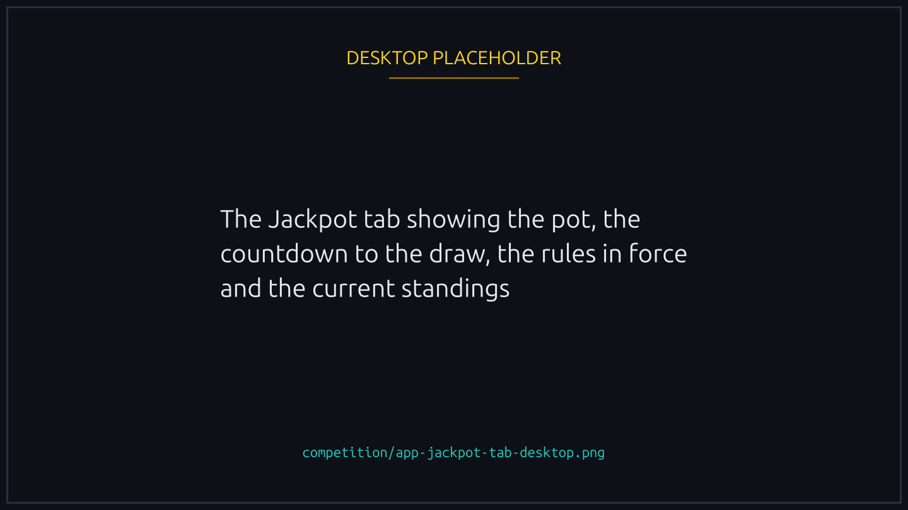
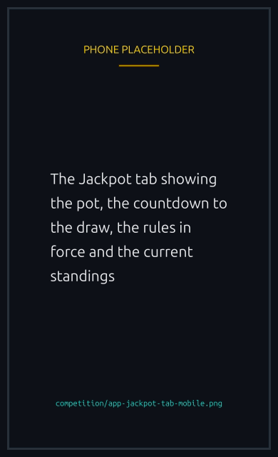
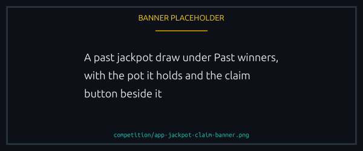
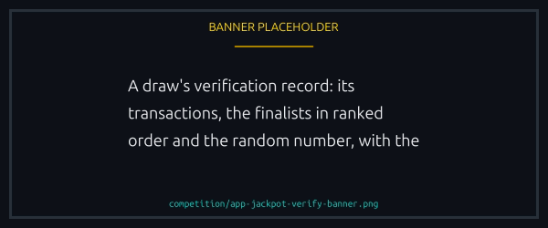

# The jackpot

The jackpot is a pot of SOL and tokens that builds up from races and is won, whole, by one of the top players of each period. There is no ticket to buy. You enter by racing well enough to finish the period near the top.

## How a jackpot runs

1. **A jackpot starts** and runs for a set number of days, from 1 to 31. Its start and end are written on chain at that moment and cannot be moved afterwards.
2. **Races feed the pot.** While it runs, every race that pays out sends a share of its prize pool to the pot.
3. **Players are ranked** on what they did during those days. The top of the ranking become the finalists.
4. **A winner is drawn** when the period ends, at 12:00 UTC on its last day. The finalists are published first, then a random number picks one of them. This takes a few minutes.
5. **The winner claims the whole pot**, and the next jackpot starts the moment the winner is known.

The Jackpot tab shows where the current one stands: the pot, the countdown to the draw, the rules in force, and the live ranking under **Current standings**.


{% column width="70%" %}

<figure><figcaption>
Where the jackpot stands: the pot, the clock and who is in front.
</figcaption></figure>



{% column width="30%" %}

<figure><figcaption>
On a phone
</figcaption></figure>




## Where the pot comes from

While a jackpot is running, every race that pays out sends a share of its prize pool to the pot, in the currency the race was run in: SOL from a SOL race, the token from a token race. That share is the jackpot fee. It sits beside the platform fee, and winners receive the pool less both. [Fees and prizes](../economy/fees-and-prizes.md#the-jackpot-fee) has the arithmetic.

- **The platform sets the rate**, never above 10% of a pool. It can be zero, which stops new races feeding the pot without touching what is already in it.
- **A race's creator can switch it off for that race**, on the create form. A race that does not feed the jackpot shows no jackpot mark, and its winners keep that share.
- **The rate is fixed when a race is created.** A later change never reprices a race you have already joined, and every race shows its rate before you sign.
- **The share is taken when the prize is claimed**, and only [while a jackpot is running](#between-two-jackpots).
- **A refund, a cancelled race and a tournament prize pay none.**

While a jackpot is running, anyone can also send SOL or a supported token straight to the pot, which is how a sponsor tops it up.

## Who can win

Only players who raced during the period can win. The platform sets 4 rules for each jackpot, and the Jackpot tab shows the ones in force.

| Rule            | What it decides                                                                   |
| --------------- | --------------------------------------------------------------------------------- |
| Period          | How long each jackpot runs: a number of days, from 1 to 31                        |
| Ranked by       | XP earned in races, races won, races lost, or races created                       |
| Finalists       | How many of the top players are entered, from 1 to 50                             |
| Who is eligible | A minimum number of races run in the period, and optionally verified players only |

Every race counts toward the ranking: paid or sponsored, in SOL or in a token. You have to race to be eligible. Creating races is not enough on its own, even when the ranking is by races created, and a race you created counts only once it has run to a result: a cancelled one does not.

Meeting those rules is all it takes to be ranked, whatever your score. With the ranking by races won, a player who has raced and not won yet is on the board with 0 wins, below everyone who has won. So in a quiet period where 10 players raced and only 2 of them won, all 10 are ranked, and with 10 finalists all 10 go into the draw.

Players level on the ranking, at zero or at any other score, are separated by the age of their player account: the one created earlier places higher. A rule change applies from the next period, never to the one being played.

If you have raced and are not ranked, the Jackpot tab says why: too few races so far, or a period open to verified players only.

The jackpot is for players who are racing now, so only what you did during the period counts, and the program itself refuses a finalist who has not raced since the period began.


A finalist needs a player account that raced during the period. Close yours before the draw and you cannot be named, whatever your rank.


## How the winner is picked

When the period ends, the platform writes the finalists on chain and, in the same transaction, asks ORAO for a random number, the same provable source [every race uses](../trust/fairness.md). When the number arrives, a published formula turns it into one position in that list, and the finalist in that position wins. Anyone can send that transaction, so nobody can sit on a result.

With the rules set to a single finalist there is no draw: the period's top player wins the pot. There is no minimum pot either. A pot is drawn whether it is large, mostly tokens, or small after a quiet period.

What you can rely on:

- **The dates are fixed in public.** A jackpot's start, end and length are written on chain when it starts and cannot be changed.
- **The finalists are public before the random number exists**, so the list cannot be chosen to fit a result.
- **Once the finalists are named, the pot can only go to the winner**, less the oracle fee for that draw's random number. From that moment nobody can stop the draw or redirect its prize, the platform included.
- **Before that, the platform can cancel a jackpot.** A cancelled jackpot has no winner, what its pot holds goes to the platform, and a new jackpot opens with an empty pot. See [Between two jackpots](#between-two-jackpots).


The ranking is computed off chain, like tournament standings, which is what lets the rules change between periods. What the chain guarantees is everything after it: the list is fixed before the randomness, the pick follows from the two, and the prize cannot go to anyone but that finalist.


## Between two jackpots

Jackpots follow each other with no gap, unless the platform holds the next one back. For a race, what counts is the moment its prize is claimed, not when the race was created, and the create form says whether a jackpot is running right now.

| Situation                                            | What happens                                                                                                                                                                                            |
| ---------------------------------------------------- | ------------------------------------------------------------------------------------------------------------------------------------------------------------------------------------------------------- |
| The winner is being drawn, which takes a few minutes | Races keep paying into the pot that is being drawn. The next jackpot starts the moment there is a winner, with standings from zero                                                                      |
| Nobody qualified, or the pot is empty                | There is no draw. The period still ends on its day, the pot keeps whatever it holds, and the next jackpot starts with that pot and fresh standings                                                      |
| The platform holds the next jackpot back             | The Jackpot tab shows that none is running. Nothing is collected meanwhile: a prize claimed then pays no jackpot share, and its winners keep it. A jackpot that is already running is never interrupted |
| The platform's rate is zero                          | New races stop feeding the pot. The jackpot that is running still ends as usual, and no new one starts while the rate is zero                                                                           |
| The random number is late                            | The draw waits, and the number is asked for again for the same finalists. A draw that has started is never cancelled                                                                                    |
| The platform cancels a jackpot before its draw       | It ends with no winner and what its pot holds goes to the platform. A new jackpot opens with an empty pot and standings from zero. Once the finalists are named this is no longer possible              |

## Claiming the prize

A jackpot is claimed, like a race prize. Win one and that draw shows a Claim button under **Past winners** on the Jackpot tab, and the prize appears with your other unclaimed winnings.

<figure><figcaption>
The draw you won waits under Past winners until you claim it.
</figcaption></figure>

- **You receive everything the pot held**: its SOL and every token, each in its own currency.
- **It lands in your wallet or your player vault**, following the same [payout target](../economy/player-vault.md#where-your-winnings-land) your race prizes use.
- **A token you have never held needs a token account**, the small deposit Solana asks to keep one open, about 0.0015 SOL each at today's rate. The claim opens it and you pay it. It is yours, and comes back if you ever close the account.
- **A pot with many tokens is claimed in several transactions.** The app sends them in order and tells you how many are left.


There is no deadline. An unclaimed prize waits for you, and nobody else can take it: anyone may send the claim, but the money can only go to the winner.


## Following along in Telegram

`/jackpot` in a group with the bot shows the pot, the next draw, the rules and the leaders. Groups also get a post when a jackpot starts, one when it ends and its finalists are named, and one when the winner is drawn, or one saying a jackpot was cancelled. The Lucky Ducks X account may post the start and the winner too. See [The Lucky Ducks Telegram bot](../help/telegram-bot.md#jackpot-announcements).

## Checking a draw yourself

Every draw under **Past winners** on the Jackpot tab has a **Verify fairness** button. It opens the draw's record: the transactions that opened, settled and paid it, the account that held the prize and the token accounts beside it, the finalists in ranked order, and the random number ORAO published. The check runs in your browser: it recomputes the winning position from that number and tells you whether it matches the winner on record.

<figure><figcaption>
The draw recomputed in your browser, from the number ORAO published.
</figcaption></figure>

The same row carries two links: the transaction that drew the winner, and a public archive of the draw holding its finalists in ranked order, the random number and the winner. With those and the formula below, anyone can recompute who should have won without relying on the app at all.

The formula, for anyone who wants to recompute a draw

Take the 64 bytes ORAO published for the draw, append the text `jackpot_winner` and the draw's number as 4 little-endian bytes, and hash the result with SHA-256. Read the first 8 bytes of the hash as a little-endian number and divide by the number of finalists. The remainder is the winner's position in the list, counting from zero.

The draw's number is part of the hash so that 2 draws could never share an outcome by sharing a random number.

