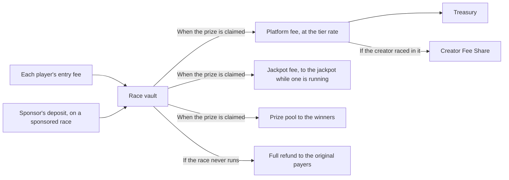
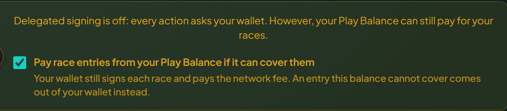
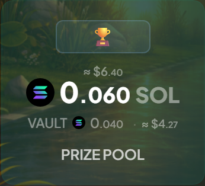
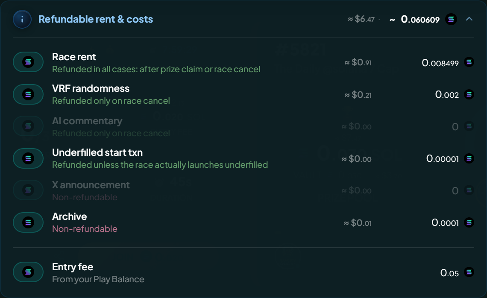

# Fees and prizes

What you pay, where it goes, and how the pool is split.

## What you pay

Your entry fee moves entirely into the race vault. When the prize is claimed the vault pays the platform fee out of the pool, the [jackpot fee](#the-jackpot-fee) too, and the rest to the winners.

The transaction you sign also covers:

- **Network fee.** Roughly 0.000005 SOL per signed transaction, Solana's standard.
- **Nothing extra on a SOL race.** A token race may need a one-time token account for that token, if your wallet has none. It costs about 0.0015 SOL at today's rent rate and comes back when you close it.

## Paying from your wallet or your vault

Every cost here can come from your wallet or from a balance you pre-fund once. The confirmation shows both with your balance beside them, and falls back to the wallet when the balance is short. See [Your player vault](player-vault.md).

The totals match either way. What changes is how often you approve something.

<figure><figcaption>
The setting decides it once, rather than asking you every race.
</figcaption></figure>

## Where the entry fee goes

| Path                        | Recipient       | When                                    |
| --------------------------- | --------------- | --------------------------------------- |
| Prize pool                  | Winner(s)       | Prize claim                             |
| Platform fee                | Treasury        | Prize claim                             |
| Jackpot fee                 | The jackpot     | Prize claim, while a jackpot is running |
| Stays in vault if cancelled | Original payers | Race cancellation                       |

The split happens inside the claim transaction, so nobody has to do anything more for the fee to be taken.

## Platform fee tiers

The rate is picked at creation from a tier schedule, against the **entry fee**, or against the sponsor's deposit on a sponsored race. It then applies to the whole pool at claim time. Small entry fees pay a higher rate, large ones less.

| Entry fee (per player) | Platform fee |
| ---------------------- | ------------ |
| Up to 0.05 SOL         | 10%          |
| Up to 0.1 SOL          | 7.5%         |
| Up to 0.5 SOL          | 5%           |
| Up to 1 SOL            | 3%           |
| Above 1 SOL            | 2%           |


Worked example: a race with a 0.1 SOL entry fee and 10 players. Entry fee falls in the second tier, so the fee is 7.5%. The pool at fill is 1 SOL. At claim the platform takes 1 × 7.5% = 0.075 SOL, and winners share the remaining 0.925 SOL.

For a sponsored race, the sponsor's deposit is what the tier is picked against (there is no per player entry fee). A 1 SOL sponsored prize sits in the 3% tier, so the platform takes 0.03 SOL at claim and winners share 0.97 SOL.

Neither example counts the [jackpot fee](#the-jackpot-fee), which a race pays on top unless its creator switched it off.


Token pools use the same percentages, with the thresholds adjusted to what that token is worth.

## The jackpot fee

A race also pays a jackpot fee: a share of its pool that goes into [the jackpot](../competition/jackpot.md), a pot won by one of the top players of each period. It is paid in the race's own currency, SOL from a SOL race and the token from a token race.

It is a second fee beside the platform fee, not a cut of it. Each is a share of the whole pool, and winners receive the pool less both. The platform sets the rate, never above 10%, and it can be zero. It is fixed when the race is created, so a later change never reprices a race you joined, and the race shows it before you sign.


Worked example: a 1 SOL pool with a 7.5% platform fee and a 5% jackpot fee. The platform takes 1 × 7.5% = 0.075 SOL, the jackpot takes 1 × 5% = 0.05 SOL, and winners share the remaining 0.875 SOL.


**The creator can switch it off for their race.** The create form has a "feeds the jackpot" choice, ticked unless the creator unticks it, and a race that feeds the jackpot carries the jackpot mark wherever its features are shown. With the platform's rate at zero the choice is not offered at all. The share is taken when the prize is claimed, and only while a jackpot is running: one claimed while the jackpot is [on hold](../competition/jackpot.md#between-two-jackpots) pays none, and the winners keep it.

**Where you see the two fees.** The create form adds them into one **Fee** figure beside the amount, so a race that feeds the jackpot shows more than its tier rate there; hover it, or tap it on a phone, for the two parts. A race's details state them apart, in a **Platform Fee** box and, on a race that feeds the jackpot, a **Jackpot Fee** box. When the jackpot's share is not being taken, that box says so: **Paused, not collected** on a race still to be paid out, **Not collected** on one already paid.

A refund, a cancelled race and a tournament prize pay no jackpot fee.

On a token race, the first claim that brings a token into the current jackpot opens the jackpot's account for that token and adds the token to its list. That costs about 0.0017 SOL at today's rent rate, paid by whoever sends the claim, and it is not returned. Every later claim in that token pays nothing for it until the next jackpot.

Creator Fee Share is a share of the platform fee alone, so the jackpot fee never changes what a creator earns.

## Prize pool calculation

- **Regular race.** Pool = entry fee × paid joiners.
- **Sponsored race.** Pool = whatever the creator deposited. Joiners pay nothing, and the fee comes out of that deposit when the prize is claimed.

## The dollar figures beside an amount

Every amount is stated in the currency it is actually paid in, with an approximate dollar value beside it. The token figure is the exact one, because it is what the transaction moves; the dollar figure is that amount at a market price, which is why it always carries a `≈`.

Which price depends on whether the thing is still running:

- **A live race or tournament** is priced at the current rate, so its dollar value moves while you watch. An open race is an offer, and an offer is worth what it is worth now.
- **One that has ended** keeps the rate from the moment it ended. Win 2 SOL with SOL at 150 dollars and the page still says so tomorrow. A finished result that quietly repriced overnight would be telling you that you won something other than what you were paid.


With no price available you see the amount and no dollar figure. A blank means the price is missing, not that the amount is worthless.


If you would rather see token amounts alone, turn the conversion off in [your preferences](../help/preferences.md).

<figure><figcaption>
The token amount is the exact one. The figure beside it is an estimate.
</figcaption></figure>

## Other costs at creation

The creator pays a few small costs at creation, separate from the pool:

- **Oracle fee** (~0.002 SOL), covering ORAO's charge for the race's seed and the three transactions that request it, read it and settle the result.
- **Archival fee** (~0.0001 SOL), for keeping a permanent public copy of the finished race.
- **Audio cost**, with AI commentary on: about 0.00005 SOL per race second, so roughly 0.0015 SOL for 30 seconds and 0.009 SOL for 3 minutes.
- **X announcement**, if enabled: flat 0.0005 SOL straight to the backend wallet, non-refundable.
- **Start-when-underfilled cost**, if opted in: paid to the platform when it starts the race for you, refunded if the race never auto starts.
- **Race account rent.** Around 0.0078 SOL for a 5 seat lobby at today's rent rate, scaling with the seats: roughly 0.0057 SOL for a 1v1 and 0.018 SOL at 20. Refunded in full when the race closes.

The oracle fee is a flat charge rather than a pass through of what the day costs. ORAO's own fee is 0.0005 SOL, and most of the rest is rent for the account the seed is written into. Fulfilling the request returns only part of that rent, and the remainder stays in the account for good. Busy moments push the transactions above their base fee, and a request that is never fulfilled returns none of that rent at all, so the real figure sits above the flat one often enough to matter. The Lucky Ducks funds that gap instead of passing it on, so what a creator pays stays the same number every time.

All of them are itemised in the cost box before you sign.

<figure><figcaption>
The same breakdown appears on the create form, before you sign.
</figcaption></figure>

## A note for creators

On a regular race, part of the platform fee goes back to the creator, provided they raced in it. No NFT is needed to earn it, and each NFT the creator brings adds more. See [Creator Fee Share](creator-fee-share.md), which also covers how it offsets the costs above.


[creator-fee-share.md](creator-fee-share.md)

