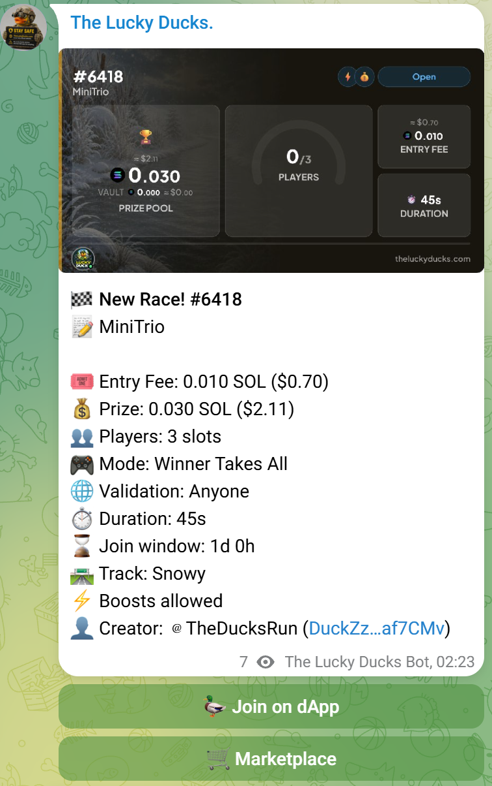
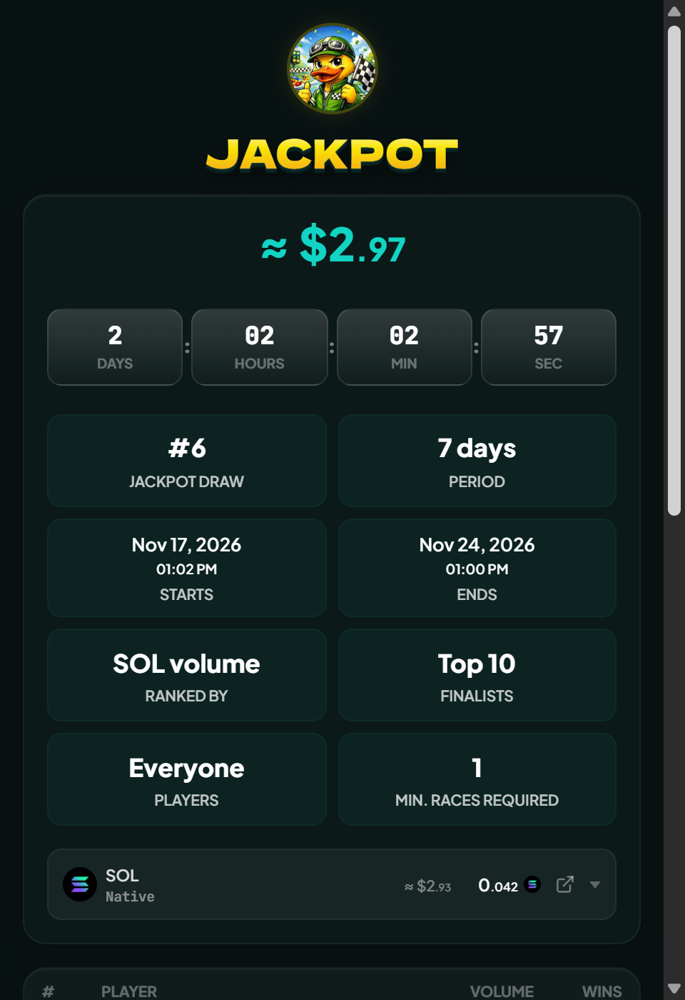
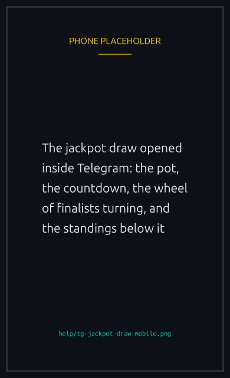
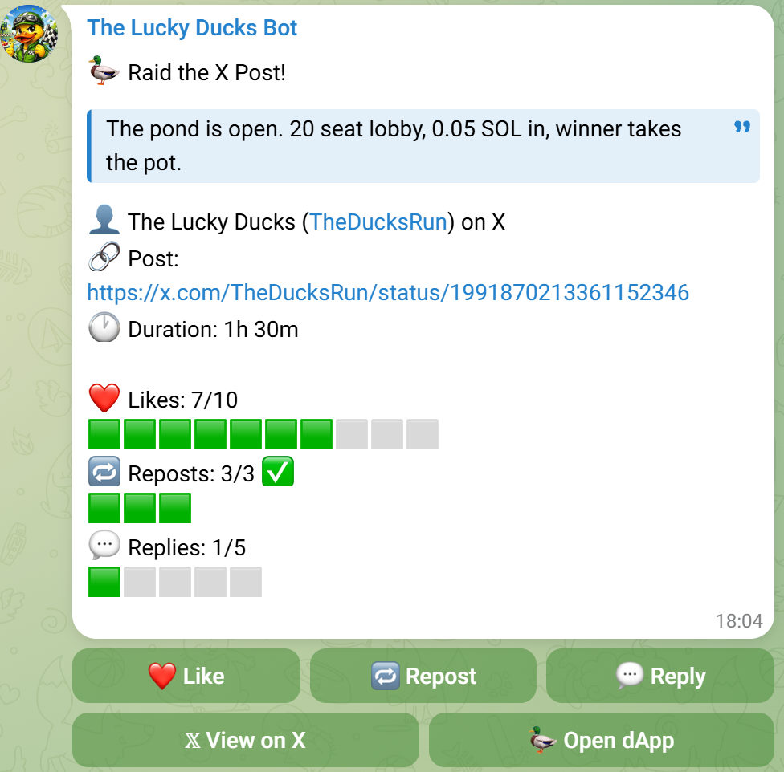

# The Lucky Ducks Telegram bot

The bot keeps a group in sync with on chain racing and rewards engagement on X. Join the main group at [t.me/TheLuckyDucks](https://t.me/TheLuckyDucks), or ask the team to set the bot up in your own. [Social networks](social-networks.md) lists every channel.

## Everyday commands

| Command        | What it does                                                                                                                                     |
| -------------- | ------------------------------------------------------------------------------------------------------------------------------------------------ |
| `/duck`        | Your player stats. `/player` and `/user` do the same                                                                                             |
| `/leaderboard` | Top players. Add `day`, `week`, `month` or `all` for a window                                                                                    |
| `/races`       | Open races                                                                                                                                       |
| `/race`        | One race in detail                                                                                                                               |
| `/team`        | Your team's stats                                                                                                                                |
| `/teams`       | Browse teams                                                                                                                                     |
| `/lottery`     | The [community lottery](../competition/community-lottery.md) line that is open, with buttons to pick a number in Telegram or on the site         |
| `/arcade`      | [The Arcade](../arcade/README.md): a button for each game, and one to the site. `/play`, `/game` and `/games` do the same                        |
| `/luckyfight`  | Play [Lucky Fight](../arcade/lucky-fight.md), or challenge someone with `/fight @handle`. `/duckfight` and `/fight` do the same                  |
| `/luckysquad`  | Play [Lucky Squad](../arcade/lucky-squad.md), the side-scrolling run-and-gun, or keep a squad to the players you name with `/luckysquad @handle` |
| `/luckyflaps`  | Play [Lucky Flaps](../arcade/lucky-flaps.md), the tap-to-flap flyer                                                                              |
| `/luckyshot`   | Play [Lucky Shot](../arcade/lucky-shot.md), the duck shooting game                                                                               |
| `/luckydodge`  | Play [Lucky Dodge](../arcade/lucky-dodge.md): dodge the falling flock                                                                            |
| `/jackpot`     | The jackpot: the pot, the next draw, the rules and the leaders                                                                                   |
| `/raidboard`   | The raid leaderboard. Add `week` or `month` for a shorter window                                                                                 |
| `/duckfact`    | A random duck fact                                                                                                                               |
| `/joke`        | A random duck joke                                                                                                                               |
| `/url`         | Every link and social                                                                                                                            |
| `/help`        | The command list                                                                                                                                 |


The bot answers these only in groups the team has set it up in, and each group answers only the commands switched on for it, so a command you use in one group may get no answer in another. A private chat with the bot answers none of them. The "/" menu in a group lists what that group answers.


## Race announcements

The bot posts a card when a race opens, and again for wins and prize claims, each linking to the race on the site. A race card carries the name, the entry fee and prize, the seats, the mode, who may join, the duration and join window, and the creator. Extras appear as their own rows when they apply: a sponsored badge, a minimum account age, a Track, AI commentary, a flexible start threshold, and whether boosts are allowed or disabled. A rematch says so instead, with its depth and the race the chain started from.

<figure><figcaption>
Announcements carry the race link, so the group can join from the chat.
</figcaption></figure>

### Why two groups show different races


Each group has its own announcement policy, set by whoever added the bot: it can be scoped to particular join settings, tokens or NFT collections, or to sponsored races only. `/races` applies the same policy, so the list in one group is not the list in another, and neither is the full list. The site always shows everything.


### How you appear on a card

Announcements name you by the first of these that exists: your Telegram handle, if you verified with Telegram and switched its display on, then your nickname, then a shortened wallet address. The first two appear with your wallet beside them, because nicknames are not unique and a card naming two people identically is worse than one with an address on it.

Your handle is shown only if you opted in, and the same switch turns it off again. See [Player verification](../trust/verification.md#telegram-handle-in-group-announcements).

## The Arcade

`/arcade` posts a button for each game of [the Arcade](../arcade/README.md), and each game's own command posts it alone, with a **Play** button that opens it inside Telegram. A group's `/arcade` offers only the games whose commands it answers. Your runs count on the same boards as on the site, and with your Telegram account linked to your wallet they earn XP and badges: see [Player verification](../trust/verification.md).

A Lucky Fight between two players gets a result post in the group, with **Rematch** and **Replay** buttons. See [Lucky Fight](../arcade/lucky-fight.md).

Groups that turn it on also see a post whenever a player opens a game to others: a Lucky Fight challenge, a Lucky Squad or a Lucky Flaps flock, over the game's animated picture, with the seats taken and a button to join. A game waiting for particular players names them, and only they can take those seats. A game started from a command such as `/fight @handle` already has its own post, so it gets no second one. A group keeps one such post for each game: a new one replaces the last.

## Jackpot announcements

The bot posts three times for each period of [the jackpot](../competition/jackpot.md): when it starts, with the draw time and the rules; when it ends, with the prize and the finalists; and when the winner is drawn, naming them with their avatar. The start post is headed **New jackpot #N**, N being the number the Jackpot tab shows for that jackpot, and it carries the jackpot picture when the platform has set one. `/jackpot` answers with the card of the jackpot that is running whenever you ask: its number, the pot as it stands, the draw time, the rules and the leaders so far. A period that ends with no winner gets one post saying the pot rolls over, and none when the pot is empty. A jackpot the platform cancels before its draw gets one post saying so, with what the pot held. Each post has a button to the Jackpot tab, **View on dApp** on the start post, and the start and winner posts gain a button to the same announcement on X when there is one. The post that the jackpot has ended goes out as the draw starts and carries **Watch the draw on Telegram**: it opens the jackpot inside Telegram, with the pot, the countdown and the wheel turning to the winner, and the standings under it. Nothing in it needs a wallet or a tap. The winner post and the answer to `/jackpot` carry **View on Telegram**, which opens the same view. Whoever added the bot to a group can switch each of those posts off for it.


{% column width="70%" %}

<figure><figcaption>
The same jackpot as on the site. At the draw, its wheel turns to the winner here.
</figcaption></figure>



{% column width="30%" %}

<figure><figcaption>
On a phone
</figcaption></figure>




## Raids: boost the post together

A **raid** rallies the group around a post from The Lucky Ducks on X. While one is live the bot keeps a card updated in place:

<figure><figcaption>
One card per raid, updated in place as the counts climb.
</figcaption></figure>

Each line shows the count against the goal, with a bar under it and a tick once the goal is met. Under the card sit Like, Repost and Reply buttons that open X with the action ready, so you never leave Telegram to find the post. When every goal lands, or the timer runs out, the card flips to a summary with the top raiders on it and the next post in the queue goes live.


You need not link anything to help a raid: **everyone's** likes, reposts and replies count toward the group goals.


### Earn points on the raid leaderboard

To have your engagement credited to you, link your X account once, from the Verification tab on the site or as a second link if you verified another way. See [Player verification](../trust/verification.md).

From then on, when a raid ends the bot tallies who engaged:

- Like = **2** points
- Repost = **3** points
- Reply = **4** points

Check standings with `/raidboard`. Points feed your global XP and unlock raid badges, listed in [Badges](../competition/badges.md).

A post raided in several groups counts once for you: each group's board credits you, but your XP and badge progress come from the post, not from each group.

Linking stays optional. Without it you still push the group goals, you just do not appear on the personal board.

## FAQ

Do I need a wallet to raid?

No. Anyone can engage with the post. Points and XP need a linked, verified wallet.

How is engagement counted?

The live card reads the post's public counts. Personal points are tallied once, when the raid ends.

Why link both X and Telegram?

It ties both identities to one wallet, so raid points and future rewards land in the right place. A second link never costs an on chain step.

