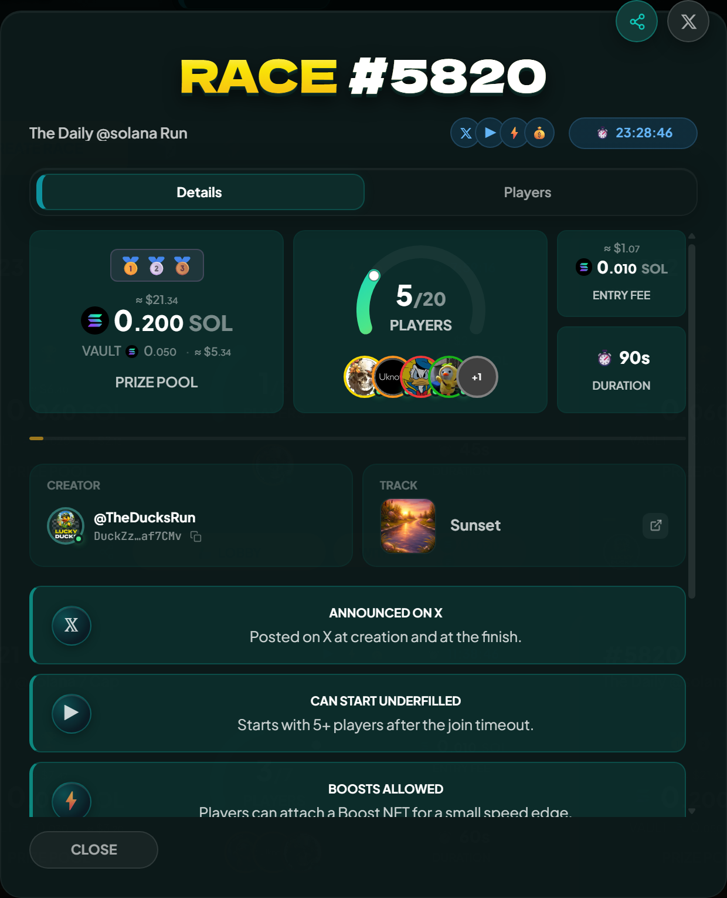
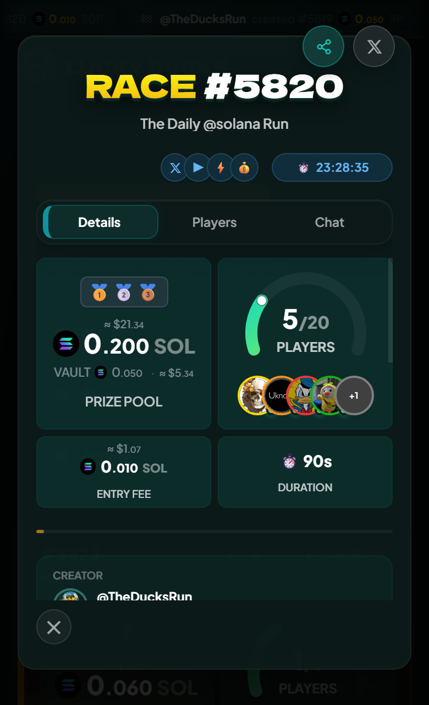

# How a race works

A race is a Solana account. Creating one allocates the account, joining deposits your entry fee into its vault, and at the end the contract pays the winners and closes it. Here is the whole lifecycle, a step at a time.

## 1. Creation

The creator picks the settings and signs one transaction:

- Entry fee (SOL or SPL token)
- Max players
- Race duration
- Payout mode (Winner Takes All, or Podium split across 1st, 2nd, 3rd)
- Optional opt ins: race name, AI commentary, custom track, custom join timeout, start when underfilled

A bigger lobby, a longer race and most opt ins need a Runner NFT. [Creating a race](../races/creating-a-race.md) has every choice and its limits.

The transaction opens the race account and the vault that holds the deposits, and the race shows up in the lobby list seconds later.

## 2. Lobby

Players join while the lobby's join window is open. Joining is one transaction: your entry fee moves into the vault, your wallet joins the participants list, and the lobby updates live over a websocket.


{% column width="70%" %}

<figure><figcaption>
The lobby updates as each join transaction confirms.
</figcaption></figure>



{% column width="30%" %}

<figure><figcaption>
On a phone
</figcaption></figure>




You can withdraw for a short while after joining. That returns your entry fee and charges a small fixed penalty, always in SOL even on token races. The penalty goes to the platform fee wallet to discourage join-and-bail griefing, and it does not swell the remaining prize pool. [Refunds and rent](../economy/refunds-and-rent.md#withdrawal-during-the-lobby) has the windows and the figure.

## 3. Start

The race starts when the lobby fills, or earlier if the creator enabled start when underfilled and the join timeout has passed. Starting is its own on chain step: the race stops taking joins and the contract requests randomness from an ORAO oracle.

Starting an underfilled race needs nobody's permission. The backend does it on schedule, and any wallet can submit it instead once the join timeout has passed and enough players are in.

## 4. The randomness arrives

ORAO publishes the seed back within seconds, in public. Anyone watching can run the same deterministic math the contract will run and know the winners before the visual race does. The backend holds the finalization transaction until the duration has elapsed, so the suspense survives.

## 5. Finalization

Once the duration is up, the backend wallet submits finalization. The contract runs the simulation, ranks the ducks and marks the race completed. Winners can claim.

Finalizing needs nobody's permission once the duration has elapsed, and no particular wallet either, so if the backend is unreachable anyone can submit it and the race still settles. In practice the backend gets there first and nobody has to.


Claims work the same way. Anyone can submit a claim for a winner, and the money still goes to the winner, into their wallet or their player vault according to their own setting.


## 6. Cleanup

The race account closes and its rent returns to the creator. If something went wrong on the way, such as the seed never arriving, the race is cancelled instead and every participant can claim a full refund.


[getting-started.md](getting-started.md)

