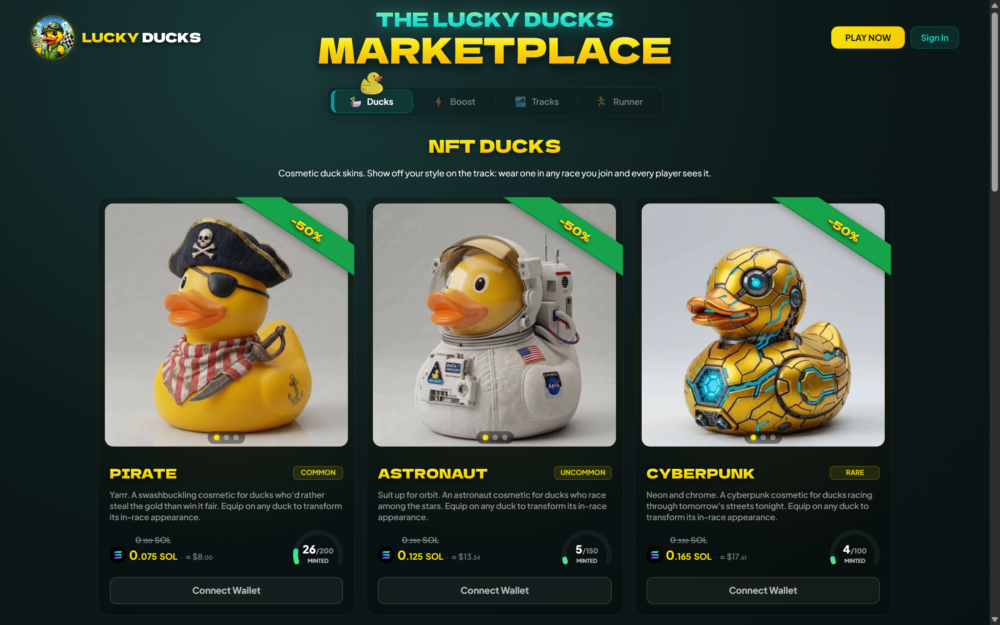
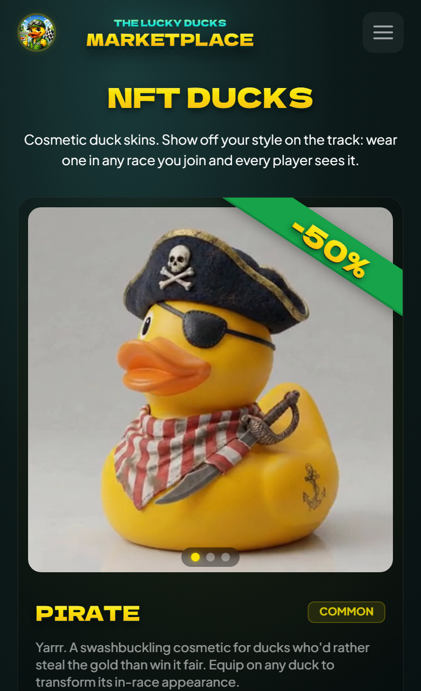
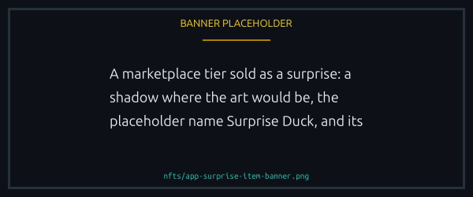

# NFT collections

Four collections, each with its own job. All four are Metaplex Core assets on Solana, tradable on The Lucky Ducks marketplace and on Tensor and MagicEden, and race actions check the connected wallet for the right one.

## The four collections

| Collection            | Purpose                           | Affects race outcome? |
| --------------------- | --------------------------------- | --------------------- |
| **Runners**           | Unlock advanced race features     | No                    |
| **Boosts**            | Add a small speed advantage       | Yes                   |
| **Tracks**            | Custom race backgrounds           | No                    |
| **Cosmetics / Ducks** | Visual customization of your duck | No                    |


Only Boosts touch who wins. The rest are access (Runners) or looks (Tracks, Cosmetics).


## How NFT detection works

Creating or joining a race scans your connected wallet for assets from the relevant collection, and one valid asset unlocks the matching features. Scans cache for a few minutes, so if you just transferred an NFT in and the page has not noticed, reconnect your wallet or reload the page.


The contract checks the NFT is in the wallet at the moment of the transaction, independently of the page. The frontend cannot fake it.


## Where to acquire

- **Mints.** New collections drop periodically, announced on the homepage and in Telegram.
- **Marketplace.** The in-app marketplace lists every NFT from The Lucky Ducks for sale, filterable by collection.
- **Third party.** Tensor and MagicEden carry the same NFTs, and buying there lands the asset in the same wallet.
- **Surprise items.** Some Duck, Track and Boost items are sold with their look kept back until you mint one. See [Surprise items](#surprise-items).
- **Mystery Boxes.** Sealed boxes that open into a random reward from the matching collection. See [Mystery Boxes](mystery-boxes.md).
- **Renting.** Some tiers rent by the day. The NFT sits in your wallet and works normally for the term, then returns on its own. See [Renting an NFT](renting.md).


{% column width="70%" %}

<figure><figcaption>
The in-app marketplace, filtered by collection.
</figcaption></figure>



{% column width="30%" %}

<figure><figcaption>
On a phone
</figcaption></figure>




## Surprise items

Some Duck, Track and Boost items are sold as a surprise: you find out what the item is when your mint lands. Until then the marketplace shows a shadow where its art would be, with a placeholder name (**Surprise Duck**, **Surprise Track** or **Surprise Boost**) and a placeholder line in place of its description. The price, the supply and the number minted are the item's own.

The mint itself works like any other. The shadow stays while your mint is on its way, and the real art, name and description take its place when it lands. A mint that fails reveals nothing, and trying again starts from the shadow.

<figure><figcaption>
The price, the supply and the count are the item's own. Only the art and the name are held back.
</figcaption></figure>


A surprise item is not a draw. Every mint of it gives the same item, and only what it looks like is kept back until you have one. For a random reward, see [Mystery Boxes](mystery-boxes.md).


Who sees the item as itself:

| Who is looking                               | What the marketplace shows          |
| -------------------------------------------- | ----------------------------------- |
| A visitor, or a wallet that holds none of it | The shadow and the placeholder name |
| The wallet that holds one, once signed in    | The item as itself                  |
| Anyone, once it has sold out                 | The item as itself, marked sold out |

While an item is still a surprise to you:

- **It cannot be rented.** The item has no Rent button until you own one or it has sold out, because a rental puts the item in your wallet and shows you what it is. See [Renting an NFT](renting.md).
- **Announcements keep it back too.** The Telegram and X posts for such a mint say that a surprise item was minted, by whom and how many are left. They do not name the item or show its art.

If you got one somewhere else and the marketplace still shows the shadow, open your NFTs there and refresh the list. It reads your wallet again, and the item then shows as itself.

Runner NFTs and Mystery Boxes are never sold this way. It is a surprise and not a secret: once somebody has minted one, the item is an ordinary NFT in their wallet, and any explorer or market shows it.

## What about royalties

The reward collections carry the Metaplex Core Royalties plugin because the standard wants it there, and the rate on it is **zero**. So no royalty is taken when you sell, on this marketplace or any other: what a buyer pays is what you receive, minus whatever that marketplace charges.

## Next

What each collection actually does:

<table data-view="cards"><thead><tr><th></th><th></th><th data-hidden data-card-target data-type="content-ref"></th><th data-hidden data-card-cover data-type="files"></th></tr></thead><tbody><tr><td><strong>Runner NFTs</strong></td><td>The access pass. Unlocks advanced race creation and lifts your daily allowance.</td><td><a href="runners.md">runners.md</a></td><td><a href="../../.gitbook/assets/nfts/nft-card-runners.png">nft-card-runners.png</a></td></tr><tr><td><strong>Boost NFTs</strong></td><td>The only collection that affects outcomes, capped at 1% on chain.</td><td><a href="boosts.md">boosts.md</a></td><td><a href="../../.gitbook/assets/nfts/nft-card-boosts.png">nft-card-boosts.png</a></td></tr><tr><td><strong>Track NFTs</strong></td><td>Custom scenery for a race you create. Visual only.</td><td><a href="tracks.md">tracks.md</a></td><td><a href="../../.gitbook/assets/nfts/nft-card-tracks.png">nft-card-tracks.png</a></td></tr><tr><td><strong>Cosmetic NFTs</strong></td><td>Wearable duck skins for your duck in a race.</td><td><a href="cosmetics.md">cosmetics.md</a></td><td><a href="../../.gitbook/assets/nfts/nft-card-cosmetics.png">nft-card-cosmetics.png</a></td></tr><tr><td><strong>Mystery Boxes</strong></td><td>Sealed boxes that open into a random reward from a themed pool.</td><td><a href="mystery-boxes.md">mystery-boxes.md</a></td><td><a href="../../.gitbook/assets/nfts/nft-card-mystery-boxes.png">nft-card-mystery-boxes.png</a></td></tr><tr><td><strong>Renting an NFT</strong></td><td>Pay by the day, race with it, and it returns on its own.</td><td><a href="renting.md">renting.md</a></td><td><a href="../../.gitbook/assets/nfts/nft-card-renting.png">nft-card-renting.png</a></td></tr></tbody></table>
