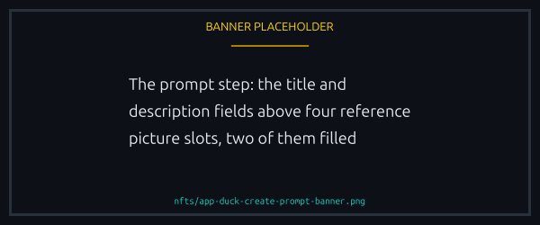
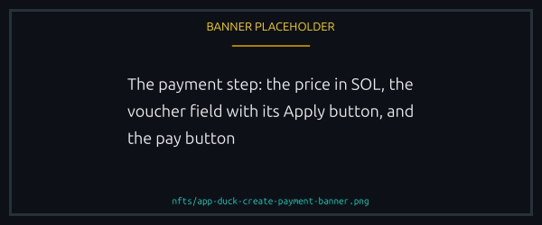
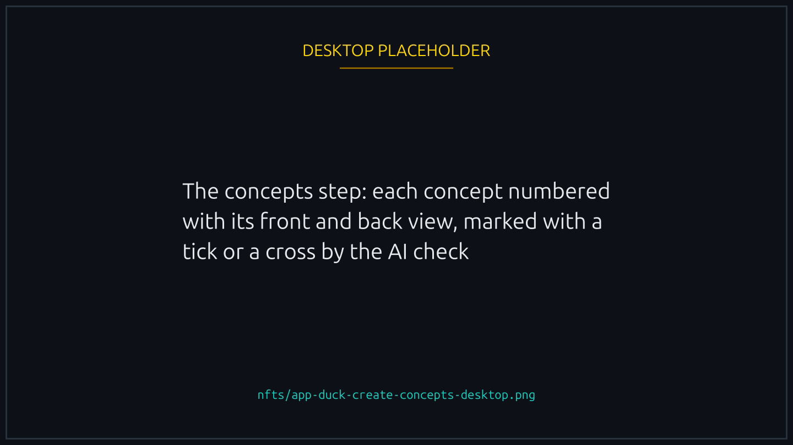
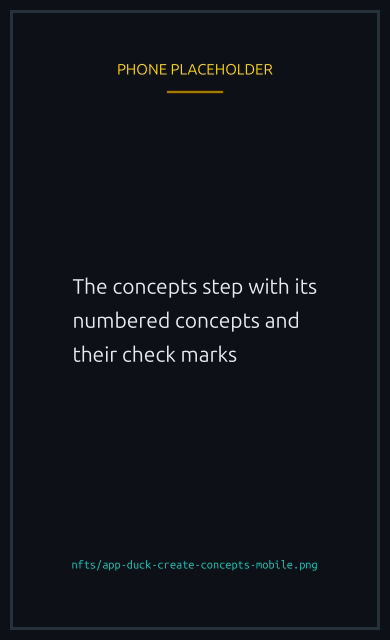
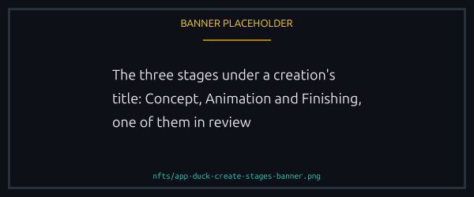
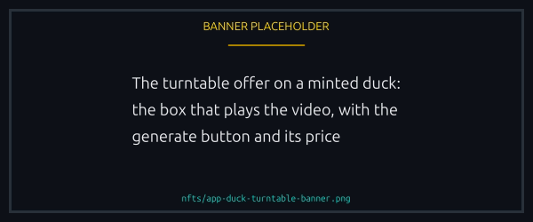
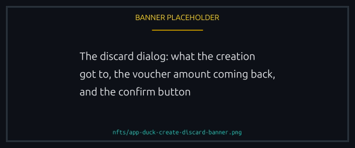
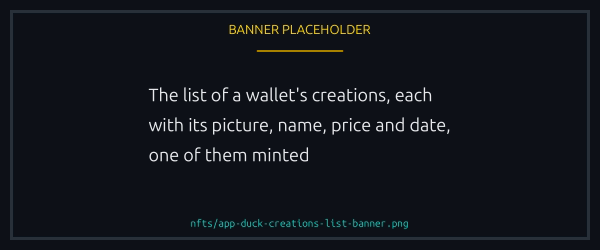

# Creating your own duck

You can have a duck made to your own design. You send a few pictures and describe it, AI draws a set of concepts, you pick one, and once a team member approves it the duck is animated and minted to your wallet as a one-of-a-kind [Cosmetic](cosmetics.md). It lives in the marketplace, on the Create tab of the top menu after the collections, which is there once you are signed in and while the team has creation open, or while you have a creation under way.


The feature is experimental and AI can make mistakes, so look over every concept before you pick one. Payments are not refunded.


<figure><figcaption>
The bar at the top says which step you are on, and you can leave and come back.
</figcaption></figure>

## How it works




### Prompt

Give your duck a title of 4 to 24 characters (it is minted as "LD Duck" followed by your title, and the whole name stays within 32) and a description of 100 to 500 characters: its outfit, mood, colours, and one gloriously unnecessary detail. Under them, add 1 to 4 reference pictures, PNG, JPEG or WebP, up to 1 MB each: pick them, or drop them onto the empty slots. Square pictures work best. Show one clear duck or character, front on, on a plain background, its whole body in frame; a back view of it helps the AI draw your duck from behind, as a race shows it.

<figure><figcaption>
One to four reference pictures. Pick them, or drop them onto the empty slots.
</figcaption></figure>





### Payment

One flat fee in SOL covers everything that follows: the concepts, the team's review, the swim animation and the mint. The step shows the price, and a [voucher](#vouchers) can lower it. Your wallet signs one transfer, and your pictures, title and description are sent with it, never before.

<figure><figcaption>
One flat fee covers the concepts, the review, the animation and the mint.
</figcaption></figure>





### Concepts

AI draws a set of concepts, each a front view and the back view your duck shows in a race. An AI check reads every picture against a standard duck (its feet, the floor, the wings, and anything drawn around it, such as sweat drops), marks it with a tick or a cross (point at a cross to see what it flagged), and the concepts are shown and numbered best first, so Concept 1 is the one the check liked most. A front view may be turned a little to one side; one drawn facing right is mirrored for you, its back view with it. The check only guides you: any picture can be picked, and if it flagged your pick, the step points you to the team on Telegram first. Pick one front and one back, which do not have to come from the same concept. If none suits you, edit the title and description and ask for another set, as many times as the step says are left.


{% column width="70%" %}

<figure><figcaption>
Numbered best first, and the mark is a guide: any picture can be picked.
</figcaption></figure>



{% column width="30%" %}

<figure><figcaption>
On a phone
</figcaption></figure>








### Submit

Look over your pick in full, and write your duck's NFT description: what wallets and marketplaces show about it, 20 to 300 characters. It is its own text, for whoever sees your duck, and not the description it was drawn from: the step refuses a copy of that. Then add up to 10 lines your duck says when someone taps it, each up to 45 characters. Write either yourself, edit it, or ask for a suggestion, which replaces what you wrote: a creation has a few of each, and each button shuts once its own are used. Then send it for review. The team member who reviews your pick reads the description and the lines too, and may correct them before approving: your duck is minted with them as they leave them.

Your creation stays on this step while it is made. Under its title, three stages show where it stands, each waiting, being made, in review or done:

1. **Concept**: a team member reviews your pick.
2. **Animation**: once your pick is approved, your duck is made to swim from its back view, and a team member checks the swim.
3. **Finishing**: the water is laid under your duck, as on every duck in a race, and a team member checks it.

<figure><figcaption>
Concept, Animation, Finishing: each waiting, being made, in review or done.
</figcaption></figure>

While the team has your duck to look at, you can ping a team member on our Telegram channel to speed things up. If they turn your pick down, you are back on the Concepts step with their note and one more set to make, and you pick again. If they turn down the swim or the finishing, the swim is made again, with nothing for you to do.





### Mint

Once the team approves the finishing, your duck is approved and minted to your wallet, with nothing more for you to do. The step shows it swimming as it will in a race, and you get a notification when your duck is approved and again when it is minted.

The duck is minted with you as its creator, on chain and in its metadata, so wallets and marketplaces credit you whoever holds it later. It carries no royalty: a resale pays nobody. Its rarity is Unique. Its files and links name the duck by a random id, never by your wallet.

Every duck minted to you counts toward the [Duck creation badges](../competition/badges.md#duck-creation). Once it is minted, you can also have a [turntable video](#turntable-video) made of it.




You can leave at any step and come back. Where a creation stands follows your wallet, so another device or browser opens it in the same place.

## Turntable video

A minted duck can have a turntable video: a short clip of it turning on the spot, in the realistic style of its picture, which wallets and marketplaces play in place of the still picture. Order one from the step where your duck hatched, or open the duck in your creations, whose Generate button takes you back to that step, for a duck made before videos were offered too. It is paid apart, one flat fee in SOL shown on its button, with no voucher. While turntable videos are not on offer the button does not show, and a video already paid for is still made.

<figure><figcaption>
Paid apart, and no voucher applies. It plays where the still picture was.
</figcaption></figure>

Once paid, the video is made from your duck as minted, and a team member checks it before it goes out; one they turn down is made again, with nothing for you to do. Once approved, it is added to your duck, and it plays in the same box. Your duck's page and your wallet may take a while to show it, as they keep what they read for a time.

## Discarding a creation

From the moment you pay until the team approves the finishing, you can discard the creation: while its concepts are being drawn, from the Concepts step, or while it is reviewed and made. What was already made is spent, and a part of the price comes back to you as a voucher for your next creation, shown the moment you discard. How much depends on how far your creation got, a stage being made counting as done: the most until your pick is approved, while the concepts are drawn and while your pick waits for review, a little less if you asked for another set of concepts, less once your pick is approved and your duck is being made to swim, less again or nothing once its animation is being made, and nothing once its finishing has started. Discarding stops whatever was being made for it. The voucher is counted on the creation's full price, even if a voucher paid part of it, and the discard asks you to confirm with the amount in front of you.

<figure><figcaption>
The amount is in front of you before you confirm, and the code is shown once.
</figcaption></figure>


A discard's voucher can be used once and is good for 30 days. Copy its code before you close the dialog: it is not shown again.


## Vouchers

A voucher takes an amount off the price of a creation. Type its code on the Payment step and press Apply, with or without its dash and in any case, and the pay button shows the lower price. A voucher worth the whole price makes the creation free, with nothing to sign.

- Each wallet can use a voucher once. A voucher can serve one wallet or several, up to a number the team sets, and a discard's voucher serves one.
- A voucher takes at most the whole price. What it is worth beyond the price is lost, unless the voucher keeps its rest: a discard's voucher always does, and the team says so for each voucher it issues. Once your creation is paid, a voucher for you alone keeps the rest under the same code, and a voucher shared with other wallets gives you a new code of your own for it, shown as your payment goes through, until the same date. Keep that code: it is not shown again.
- A voucher is refused once it has expired, been used up, or been withdrawn by the team.
- It counts as used when your creation is paid for. If your payment does not go through, the use is given back.

Vouchers come from discards, and the team can issue them too.

## Your creations

Once you have made a creation, the Create tab lists them, newest first: each with its picture and name, its price and date, and once minted your duck's address with copy, the explorer and its page, as your other NFTs show it. Click a creation to see its whole process: your prompt and pictures, every concept with your pick, the team's notes, and its transactions, and once it is minted your duck's address, with its page, and its turntable video, or the offer of one. Create a new duck starts another. A wallet can create up to 99 ducks.

<figure><figcaption>
Newest first. A minted one carries its duck's address and its page.
</figcaption></figure>


Some time after a creation ends, discarded or minted, its pictures move to IPFS, a public file network, your reference pictures included. They still show in your list as before, and anyone with a link to one can open it.



[cosmetics.md](cosmetics.md)

