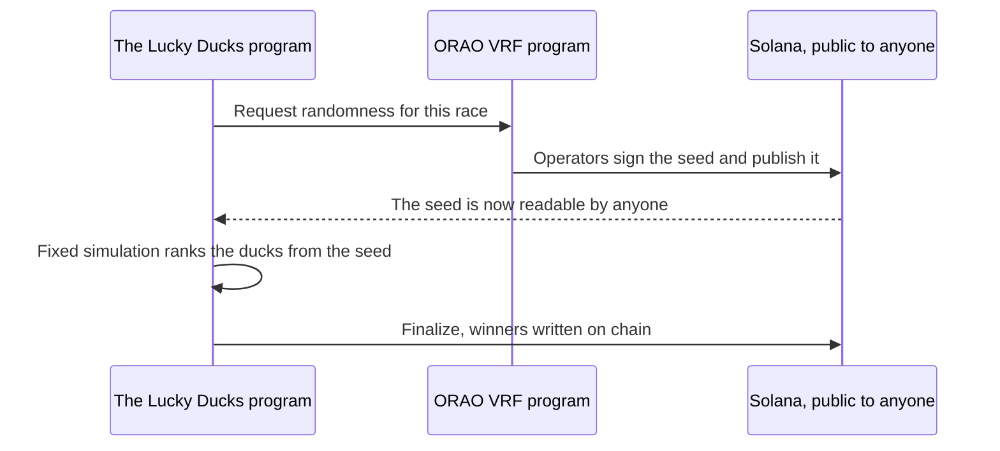

# Provable randomness

The most important property of The Lucky Ducks is that the platform cannot pick a winner. Here is how.

## The actor: ORAO Verifiable Random Function (VRF)

ORAO is a Solana-native randomness oracle. When the contract needs a seed it sends a `request` to the ORAO program, and ORAO's operators, a distributed set of network participants, compute the response, sign it with their VRF keys and write it back to Solana.


That signed seed is publicly verifiable: anyone can check it came from the right key over the right inputs, and ORAO cannot change it afterwards.


## How the seed becomes a winner

Once the seed is on chain the outcome is fixed. The contract holds one simulation function, and from the seed, the participant list and the boosts it computes a strict ranking, first to last.

That same function runs in the canvas, so the animation matches the chain, and in finalization, so the payouts match the animation. The two are identical.

## Anyone can predict the outcome early

Deliberately so. Between ORAO publishing the seed and the race duration elapsing, anyone watching the chain can run the contract's math and know the result. The visual race is delivery; the maths is already done.

The backend holds finalization until the timer ends so the suspense survives, and from that instant anyone at all can submit it instead, because the instruction requires no signer (see [How a race works](../introduction/how-it-works.md#5-finalization)). If you genuinely want to know early, you can. Most players would rather watch.

## What if the seed never arrives?

The contract splits the wait at one instant: the VRF timeout, around 3 minutes from the moment the race is waiting on randomness. Before it, the race can only start. After it, the race can only be refunded. Exactly one is possible at any moment and the contract enforces the boundary, so the backend cannot hold a race pending past it.

Nothing fires on its own at the deadline. The race does not auto-cancel; the refund merely becomes possible, and anyone can submit it. [Refunds and rent](../economy/refunds-and-rent.md#who-triggers-it-and-who-pays-for-it) says who does, and where the refund shows up for you.


**A refund returns every stake in one transaction and closes the race.** Nobody can refund only themselves.


That boundary is the part that matters for fairness. The seed is public the instant it lands, so if starting and refunding overlapped, a player could read the result, dislike it and exit instead of paying the winner. Because the windows meet exactly and a refund is all or nothing, the worst anyone can do is void a race that was already too late to run, which returns their own stake along with everyone else's.

## What if I do not trust ORAO?

Read their audits, watch their on-chain operator set, or simply note that the seed is signed and the maths is public. There is no path by which the platform substitutes a seed of its own: the contract accepts only seeds signed by the ORAO program's authorised keys.

## What if the seed is biased?

ORAO uses a VRF scheme, so the seed is the output of a one-way function over inputs the contract chooses, including the request transaction's slot. Nobody, ORAO included, can predict it before submitting, and the output is unique per request and uniform across the possibility space.

## Why ORAO

ORAO rather than Switchboard or another VRF, for four reasons. All of them matter more in a 30 second race than they would in a lending protocol that reads a price once an hour.

**Latency, because the seed gates the race.** The race stops taking joins and then waits: no seed, no start, so the oracle's response time is the player's waiting time. ORAO typically fulfils within seconds and usually inside a minute even under load, which is what keeps a full lobby from sitting there. The contract puts a hard edge on that wait at the [VRF timeout](#what-if-the-seed-never-arrives), after which the race can only be refunded.

**Cost, per race and paid up front.** Randomness here is not a protocol-level subscription amortised over many reads. Each race buys its own, and the creator funds it: the oracle's cost is moved into the race vault by the create transaction, so the race can pay the oracle at request time whether or not it ever fills. The creator pays a flat oracle fee and the platform covers whatever the randomness costs above it, which keeps it cheap enough to run races all day. See [Fees and prizes](../economy/fees-and-prizes.md#other-costs-at-creation).

**A request model that is one account, owned by the oracle.** Requesting creates a single randomness account by calling the ORAO program, and ORAO's own fulfilment authority writes the seed into it. The account belongs to ORAO's program rather than to The Lucky Ducks, which is exactly what makes the seed checkable by a stranger and unchangeable by us. Fewer moving parts than a queue with cranks to keep alive, and one account address to hand a sceptic. [Verifying a race on-chain](verifying-a-race.md) walks that check.

**Support that answers.** When an oracle does misbehave, the question is how quickly a human helps. ORAO's team has been fast to respond, which is worth more than a feature table at the moment a race is stuck.

None of it asks you to trust ORAO: the seed is signed, the account is theirs rather than ours, and the maths on top is public.


[verifying-a-race.md](verifying-a-race.md)

